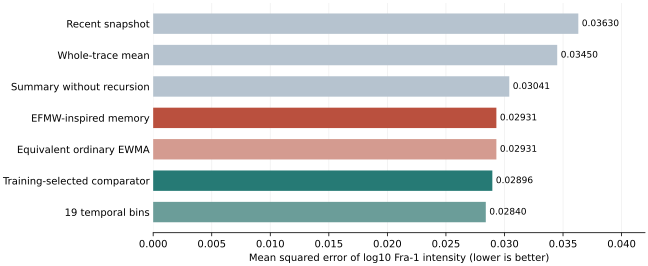

# EFMW-BIO-001: A Negative Benchmark Result for an EFMW-Inspired Memory Feature in Single-Cell ERK Signaling

**Matthew Chenoweth Wright**  
Monolithic LLC · 25 October 2026  
**Status:** AI-assisted computational research preprint; exploratory reanalysis of public experimental measurements; not peer reviewed.

**Companion:** [protocol, executable analysis, provenance, and complete result tables](research/efmw-bio-001/README.md).

## Abstract

A recursive feature can improve a weak predictor without providing an advantage over an equivalent conventional method. We tested this distinction in EFMW-BIO-001, an exploratory transfer of a fixed EFMW-inspired memory recurrence to publicly available single-cell ERK signaling measurements. The downloaded MCF10A tables contained 71,459 cells from three experimental replicates, with 190 ERK samples and eight nuclear immunofluorescence readouts per cell. A frozen trace-completeness rule retained 70,987 cells. The primary target was log-transformed nuclear Fra-1 intensity. Nested evaluation held out an entire experimental replicate at a time, while feature scaling, ridge tuning, and conventional-comparator selection used only the other replicates. Adding the fixed memory feature to four elementary trace summaries reduced the primary mean squared error from 0.03040942 to 0.02930860, a 3.62% reduction. However, the training-selected conventional comparator achieved 0.02896365, making the candidate's error 1.19% higher. An independently implemented ordinary exponential moving average produced the same predictions to floating-point precision. The candidate also had higher aggregate error than the selected comparator on all seven secondary readouts. The prespecified practical performance criterion therefore failed. Interpretation is restricted by the three-replicate sample, upstream normalization that used all replicates, unequal feature counts among non-equivalent comparators, and the use of a single cell line. The result supports a narrow computational benefit from an additional temporal feature relative to its ablation, but supplies no evidence of an EFMW-specific advantage or a new biological mechanism.

**Keywords:** ERK signaling; cellular memory; negative results; exponential moving average; nested cross-validation; biological model benchmarking; reproducibility; EFMW.

## 1. Research question

The EFMW research program includes recursive monitoring methods alongside broader mathematical and physical proposals. A practical biological application must specify an observable, an executable prediction rule, and a comparison that can distinguish the proposed contribution from established techniques. This study addresses one such prediction task: estimating a measured downstream nuclear readout from the preceding ERK activity trace of the same cell.

The empirical starting point is the live-cell and fixed-cell dataset of Ram and colleagues [1,2]. The present work is a secondary computational analysis. It neither generated those biological measurements nor independently replicated their laboratory acquisition.

Three questions are separated:

1. Does adding the selected recursive feature improve the same model without that feature?
2. Does the resulting predictor outperform conventional alternatives chosen without inspecting the outer test outcomes?
3. Is the selected recursive operation mathematically distinct from ordinary filtering?

An affirmative answer to the first question would not establish the second or third. In particular, describing a variable as memory does not identify a biological storage mechanism. The primary claim under evaluation is a predictive advantage of one explicitly transferred feature, rather than the validity of the full EFMW framework.

## 2. Data, provenance, and scope

We used `df_erk_MCF10A.xlsx`, `df_ETGs_MCF10A.xlsx`, and `df_tx_MCF10A.xlsx` from `SourceData.zip/SupplementaryData1` in the versioned public deposit [2]. The authors' README specifies row-wise correspondence between these files. Their sizes and SHA256 digests are recorded in the [source manifest](research/efmw-bio-001/source/source_file_hashes.json). Selected ZIP members were checked against their archive CRC values; the complete outer ZIP was not downloaded, so whole-archive MD5 verification is not claimed.

The files contained 71,459 rows, 190 time samples per ERK trace, eight nuclear readouts, three replicate identifiers, and 242 distinct replicate/well combinations. The publication reports 97,960 cells for Figure 2 [1]. The reason for the difference between that figure count and the downloadable tables has not been established. All sample counts in this paper refer to the actual downloaded tables.

The primary outcome was

$$
y_i=\log_{10}(\mathrm{FRA1\_nuc}_i).
$$

The seven secondary outcomes were EGR1, pERK, c-Jun, c-Myc, phosphorylated c-Fos, c-Fos, and phosphorylated Rb nuclear intensities. The source column `PERK_nuc` denotes the pERK readout in this dataset. Secondary outcomes were retained as a fixed set rather than screened to identify a favorable result.

ERK inputs are the authors' calibrated and normalized assay readouts. Outcomes are the authors' processed immunofluorescence intensities. These quantities have not been derived as physical EFMW field variables. The task uses the complete preceding trace to predict a measured endpoint; it does not forecast a later clinical event.

### 2.1 Quality rules

Before reading individual outcomes or fitting predictors, the analysis required at least 152 finite samples out of 190 for each trace. This excluded 472 cells and retained 70,987. There were 304,549 missing samples among the retained traces before interpolation. Missing values were interpolated linearly within the same cell's observed sequence; the nearest observed value was carried at either endpoint. No other cell or protein outcome was used for interpolation. All retained cells had positive finite values for all eight targets. No outcome-based outlier exclusion or winsorization was applied.

### 2.2 A known upstream independence limitation

The published stain normalization used matched-treatment summaries across all three experimental replicates, aligning the first two to the third in log space [1]. Thus the available labels already incorporate cross-replicate information before our model-fitting split. The downstream evaluation excludes the test replicate from our own fitting and tuning, but the entire measurement-to-prediction pipeline is not an untouched external test. This limitation was recorded before execution and prevents an independent-validation claim.

## 3. Frozen candidate and an elementary equivalence result

The recurrence was taken from the existing EFMW-EXP-001 monitor [3], whose archived source is included [here](research/efmw-bio-001/source/monitors_original.py). That monitor forms a synthetic controlled-plant residual and updates a scalar state with coefficient 0.97. For this biological transfer, the controlled-plant equation was explicitly removed and the observed ERK value supplied as the input. The resulting feature is

$$
m_{i,0}=0,\qquad
m_{i,t}=0.97m_{i,t-1}+0.03x_{i,t},\quad t=1,\ldots,189,
$$

$$
c_i=|m_{i,189}|.
$$

The first sample, indexed zero, does not drive the recurrence because the source implementation initializes that state to zero. The coefficient was not tuned on these biological outcomes. This is a documented feature transfer, not an unchanged replication of EFMW-EXP-001 or a derivation from the canonical EFMW field equation.

**Proposition 1 — equivalence to a conventional exponential filter.** For any real input sequence and zero initial state, the recurrence above has the closed form

$$
m_{i,t}=0.03\sum_{k=1}^{t}0.97^{t-k}x_{i,k}.
$$

**Proof.** At $t=1$, the update gives $m_{i,1}=0.03x_{i,1}$. If the expression holds at $t-1$, substituting it into the recurrence multiplies each earlier coefficient by 0.97 and adds the term $0.03x_{i,t}$. This is precisely the displayed sum at $t$. Induction proves the result. Taking the same absolute value at the endpoint preserves equality. □

This proposition is an elementary identity, not a new mathematical result. It establishes that the tested operation is the zero-initialized exponential moving average in another notation. A separately implemented finite weighted sum was therefore included as an equivalence control. Predictive improvement cannot establish algorithmic novelty for two identical operations.

## 4. Prediction models and evaluation

### 4.1 Model roster

The elementary summary vector comprised whole-trace mean, population standard deviation, mean of the first ten samples, and mean of the last ten samples. The candidate appended $c_i$ to those four predictors.

| Model | Number of predictors | Definition |
|---|---:|---|
| Training mean | 0 | Intercept-only prediction |
| Recent snapshot | 1 | Mean of the final ten samples |
| Whole-trace mean | 1 | Mean of all 190 samples |
| Summary ablation | 4 | The four elementary summaries |
| EFMW-inspired memory | 5 | Summary vector plus fixed absolute recursive state |
| Matched ordinary EWMA | 5 | Same summaries plus the independently calculated equivalent state |
| Multiscale EMA | 10 | Summaries plus six signed exponential-filter endpoints |
| Temporal bins | 19 | Means of nineteen consecutive ten-sample blocks |
| Production-decay filters | 13 | Summaries plus nine two-stage linear-filter endpoints |

The multiscale coefficients were fixed at $0.5,0.8,0.9,0.97,0.99,0.995$. The two-stage filters used

$$
u_t=a u_{t-1}+(1-a)x_t,\qquad
v_t=b v_{t-1}+(1-b)u_t,
$$

with zero initial states and all nine pairs $(a,b)\in\{0.8,0.97,0.995\}^2$. This is a simple discrete production-decay surrogate. It does not reproduce the full nonlinear biological ODE or convolutional neural network of the source study.

### 4.2 Fitting and nested selection

All non-intercept models used weighted standardization followed by ridge regression with an unpenalized intercept. The penalty grid was fixed at $\{0.1,1,10,100,1000\}$. Each outer fold held out one complete experimental replicate. Within the other two replicates, each was used in turn as an inner validation set while the remaining replicate supplied training data. The mean inner validation score selected the ridge penalty; ties favored the first, smaller penalty.

The conventional comparator was also selected within this inner evaluation, from snapshot, whole-trace mean, summary ablation, multiscale EMA, temporal bins, and production-decay filters. Each selected model was then refit using both outer-training replicates. The equivalent EWMA control was evaluated separately because its role was to check mathematical identity.

All models received the same assay modalities and split structure. Their feature counts were not equal: equal ridge grids do not mean equal overall model capacity. The matched EWMA control, however, was exactly equal in both feature count and mathematical specification. Neither treatment identifiers, replicate identifiers, well identifiers, nor other protein measurements were predictors.

### 4.3 Weighting and score

Training weights gave equal total mass to each training replicate, equal mass to each well within that replicate, and equal mass to cells within a well. These weights were rescaled to sum to the training cell count. Predictor centering and scaling used only the corresponding training data.

For held-out replicate $g$, let $\mathcal W_g$ be its wells and $n_{gw}$ the number of retained cells in well $w$. The primary fold score was

$$
L_g=\frac{1}{|\mathcal W_g|}\sum_{w\in\mathcal W_g}
\frac{1}{n_{gw}}\sum_{i\in(g,w)}(y_i-\widehat y_i)^2.
$$

The aggregate score was $L=(L_1+L_2+L_3)/3$. Relative error reduction versus comparator $B$ was defined as

$$
G_B=100\left(1-\frac{L_{\mathrm{candidate}}}{L_B}\right)\%.
$$

Positive $G_B$ favors the candidate. Negative values indicate higher candidate error. Mean absolute error and replicate-specific $R^2$ were also recorded; reported aggregate $R^2$ is the arithmetic mean of the three replicate values.

### 4.4 Frozen decision rule

The [protocol](research/efmw-bio-001/PROTOCOL.md) was locally frozen before individual protein outcomes were loaded and before prediction models were fit. The public study and its reported biological associations were already known. This was not an externally registered preregistration.

The practical screen required all of the following: at least 5% lower aggregate primary MSE than the training-selected comparator; lower MSE in each of the three outer folds; and lower MSE than the summary ablation in each fold. Five percent was an analysis-design threshold, not a biological or clinical significance threshold. Even a pass would remain provisional given upstream normalization and limited experimental replication.

## 5. Results

### 5.1 Primary outcome

| Model | Aggregate MSE of log10 Fra-1 | Mean replicate $R^2$ |
|---|---:|---:|
| Training mean | 0.04585244 | -0.035311 |
| Recent snapshot | 0.03630495 | 0.176086 |
| Whole-trace mean | 0.03450232 | 0.213217 |
| Summary ablation | 0.03040942 | 0.309575 |
| **EFMW-inspired memory** | **0.02930860** | **0.334377** |
| Matched ordinary EWMA | 0.02930860 | 0.334377 |
| Multiscale EMA | 0.02912064 | 0.338526 |
| Temporal bins | 0.02840398 | 0.352726 |
| Production-decay filters | 0.02899111 | 0.341339 |
| **Training-selected conventional comparator** | **0.02896365** | **0.342033** |



*Figure 1. Primary errors averaged across wells and experimental replicates. Smaller values indicate better prediction. The nineteen-bin model is shown descriptively; its favorable outer-test score was not used to choose the primary comparator after evaluation.*

Adding the memory feature reduced MSE relative to the four-feature ablation by **3.619986%**, but increased MSE relative to the training-selected conventional comparator by **1.190973%**. The latter comparison has absolute difference $0.0003449493$ in squared log10 intensity units. These error percentages are not percentage changes in protein abundance.

### 5.2 Results by held-out experimental replicate

| Held-out replicate | Test cells | Test wells | Candidate MSE | Selected comparator MSE | Comparator selected on training data |
|---|---:|---:|---:|---:|---|
| 1 | 27,644 | 83 | 0.03280553 | 0.03232688 | Production-decay filters |
| 2 | 26,974 | 85 | 0.02685230 | 0.02658310 | Temporal bins |
| 3 | 16,369 | 74 | 0.02826798 | 0.02798098 | Temporal bins |

The candidate improved upon its ablation in every replicate but had higher error than the selected conventional comparator in every replicate. It therefore failed the practical screen without requiring a decision based on statistical significance.

### 5.3 Equivalence control

The recursive and closed-form memory features differed by at most approximately $9.99\times10^{-16}$ in the processed data. Their primary predictions differed by at most $1.78\times10^{-15}$ in log10 units, and their aggregate primary MSEs were identical at the reported precision. These numerical checks agree with Proposition 1.

### 5.4 All secondary readouts

| Nuclear readout | Error reduction versus ablation | Error reduction versus selected comparator | Practical screen |
|---|---:|---:|---|
| Fra-1, primary | +3.62% | -1.19% | Failed |
| EGR1 | +0.60% | -1.11% | Failed |
| pERK | +1.43% | -5.55% | Failed |
| c-Jun | -0.12% | -2.78% | Failed |
| c-Myc | +2.61% | -4.45% | Failed |
| Phosphorylated c-Fos | +7.17% | -2.38% | Failed |
| c-Fos | +0.76% | -2.00% | Failed |
| Phosphorylated Rb | +6.26% | -1.71% | Failed |

The strongest ablation improvements did not survive the conventional comparison. No secondary target was promoted after observing these results. Complete fold-level MSE, MAE, $R^2$, cell counts, and selected penalties are available in [fold_metrics.csv](research/efmw-bio-001/results/fold_metrics.csv).

## 6. Uncertainty and limits of inference

The relevant count of independent experimental acquisitions is three, not 70,987. Exact enumeration of sign flips for the three primary fold differences gives a two-sided value of 0.25. With three differences, 0.25 is the smallest attainable two-sided value for this calculation. Furthermore, outer folds share training data, so the exchangeability assumptions needed for a formal inferential interpretation are not automatically satisfied. We report this enumeration descriptively and make no statistical-significance claim.

A whole-replicate bootstrap with seed 20261025 and 20,000 resamples gave a descriptive 2.5th-to-97.5th percentile range of **[-1.48%, -1.01%]** for relative primary error reduction. Three source replicates provide very coarse resampling support. The range is not a reliable population-level confidence interval and does not override the preceding limitations.

Other restrictions are substantial. The assay comes from one cell line in one laboratory. Published preprocessing was not reconstructed from raw microscopy. The source labels already use cross-replicate normalization. Missing trace values were interpolated. Downloaded and figure-reported cell counts differ. The comparator family is finite, feature counts differ, and no globally optimal conventional predictor is claimed. This work does not reproduce the source paper's full model roster, and it is not a basis for revising that paper's reported rankings.

## 7. Evidence audit

| Claim or obligation | Classification | Reason |
|---|---|---|
| The added feature lowers primary error relative to its ablation in these processed data | Demonstrated computationally; broader support incomplete | 3.62% aggregate reduction and improvement in all three evaluated folds |
| The candidate passes the frozen conventional-comparator screen | Rejected for this experiment | Higher primary error in all three folds; aggregate reduction is negative |
| The selected recurrence is a distinct memory algorithm | Rejected | Elementary closed-form equivalence to ordinary EWMA |
| Our model fitting excludes the outer test replicate | Demonstrated computationally | Grouped splits and training-only tuning |
| The full preprocessing pipeline is independent of the outer test replicate | Not satisfied | Author-supplied outcome normalization spans replicates |
| The feature identifies a cellular memory mechanism | Unresolved; not established | Prediction alone and an abstract filter identity do not identify a mechanism |
| The experiment validates or refutes the full physical EFMW framework | Not tested | No physical field-to-observable derivation or framework-wide test was supplied |

The audit follows frozen-scope, anti-circularity, equivalence, and reproducibility rules. It does not claim execution of a complete catalog of named Zoo animal operations. Numerical agreement between two software implementations is a verification check, not independent biological replication.

## 8. Reproducibility and implementation checks

The original protocol SHA256 is

```text
38e028fbbe057c9f0cb718a231365e3fc45153ecd4002bd76b678ea8f3ba403b
```

The [freeze record](research/efmw-bio-001/protocol_freeze.json) and [analysis-code hashes](research/efmw-bio-001/code_freeze.json) accompany the manuscript. Python 3.12.14, NumPy 2.3.5, and SciPy 1.17.0 were used; the complete package versions are pinned in [requirements.txt](research/efmw-bio-001/requirements.txt).

Independent pandas aggregation reconstructed all **240 fold/model/target score rows**, with maximum MSE difference $1.11\times10^{-16}$. A separate scikit-learn fit reproduced the primary candidate's third outer-fold predictions within $6.66\times10^{-15}$. A second extraction method agreed on **570 source numeric values**. The frozen benchmark was subsequently reproduced with the same scores. These checks are documented in [verification.json](research/efmw-bio-001/results/verification.json).

An initial prediction-output archive was truncated. It was recovered by refitting the already-recorded penalties and comparator choices without new tuning. Every recovered fold score agreed with the existing results within $9.72\times10^{-17}$. The [recovery log](research/efmw-bio-001/results/archive_recovery.json) is retained. A staging wrapper now checks complete output archives before exposing them as finished results; it leaves the frozen numerical runner unchanged.

The public companion contains the protocol, original numerical runner, data-retrieval and preparation scripts, results, verification records, source checksums, and figure. Large numeric archives are regenerated from the public source deposit rather than embedded in Git. The [companion README](research/efmw-bio-001/README.md) provides exact commands and identifies the distinction between committed results and regenerated per-cell arrays.

## 9. Discussion

The first question has a restricted positive answer: this extra temporal feature improved the specified four-feature model's primary prediction score. However, the feature adds a degree of representation that its ablation lacks. The improvement therefore cannot be attributed to a distinctive physical principle. The exact conventional EWMA comparison is decisive on this point: the same operation under a conventional name yields the same predictions.

The conventional-model comparison has a negative answer for the frozen screen. A model chosen solely from training data performed better in each outer fold. The conclusion is not that all temporal-memory models fail in biology, nor that this dataset disproves every EFMW proposal. It is that this particular transfer provides no evidence for superiority over the specified alternatives.

The most useful next step is to require a candidate to state its distinction from ordinary filtering before another superiority claim is tested. Any new mechanism would need a definition, a measurement mapping, and predictions not obtainable simply by renaming an existing filter. Empirical evaluation would then require additional independent experimental acquisitions and preprocessing fitted without test-outcome information. The present dataset should be treated as explored once it has informed a revised design.

## 10. Conclusion

EFMW-BIO-001 produced a reproducible negative result for one proposed biological application. The fixed memory feature improved its immediate ablation by 3.62% in primary MSE, but was 1.19% worse than the training-selected conventional comparator and mathematically equivalent to ordinary exponential averaging. The conventional comparison was unfavorable on all eight measured readouts. These findings narrow the supported claim to a modest, conventional temporal-feature benefit in processed assay data, with broader biological and physical claims remaining unestablished.

## Declarations

**Data attribution and license.** The biological data were produced by Abhineet Ram, Michael Pargett, Yongin Choi, Devan A. Murphy, Carolyn Teragawa, Markhus Cabel, Nont Kosaisawe, Gerald Quon, and John Albeck. Their Figshare deposit is licensed CC BY 4.0 [2]. This reanalysis applies additional trace-quality filtering, within-trace interpolation, feature construction, and model fitting; it does not attribute those transformations to the original authors. No new wet-laboratory experiment or clinical intervention was performed.

**AI assistance.** ChatGPT assisted with study specification, implementation, execution, numerical checking, and manuscript drafting. The computations and artifacts are provided for inspection. No independent human peer review or independent laboratory replication is represented as having occurred.

**Competing interest.** Matthew Chenoweth Wright founded Monolithic LLC, which develops EFMW-related work. The negative result and its limitations are reported without a claim of commercial or clinical performance.

## References

1. Ram A, Pargett M, Choi Y, Murphy D, Teragawa C, Cabel M, Kosaisawe N, Quon G, Albeck JG. **Deciphering the history of ERK activity from fixed-cell immunofluorescence measurements.** *Nature Communications*. 2025;16:4721. [doi:10.1038/s41467-025-58348-7](https://doi.org/10.1038/s41467-025-58348-7).
2. Ram A and colleagues. **Deciphering the History of ERK Activity from Fixed-Cell Immunofluorescence Measurements.** Figshare dataset, version 1. [doi:10.6084/m9.figshare.27047617.v1](https://doi.org/10.6084/m9.figshare.27047617.v1). [CC BY 4.0](https://creativecommons.org/licenses/by/4.0/).
3. Wright MC / enuminous. **EFMW-EXP-001, `monitors.py`.** GitHub source retrieved 25 October 2026; exact Git blob `aef763fa47d15a7438f9f917700d59209c13724a`. [Repository source](https://github.com/enuminous/EFMW-EXP-001/blob/main/monitors.py); [archived contents used here](research/efmw-bio-001/source/monitors_original.py).
