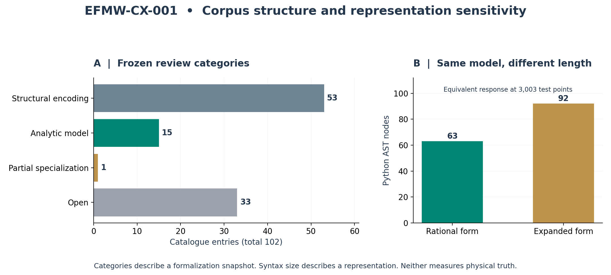

# EFMW-CX-001: How Complex Is EFMW Compared with Other Physical Frameworks?

*An executed corpus audit and a sixteen-framework literature comparison*

**Prepared for:** Matthew Chenoweth Wright / Monolithic LLC  
**Research and coding:** AI-assisted by Codex  
**Date:** 29 October 2026  
**Status:** Exploratory comparative report; not peer reviewed.

This GitHub-readable edition preserves the completed report's findings, tables,
sixteen framework profiles, and nineteen references. It adds publication links;
the frozen protocol, measured results, and original HTML report are unchanged.

**Companion materials:** [Reproduction guide](research/efmw-cx-001/README.md) ·
[Original HTML report](research/efmw-cx-001/report.html) ·
[Download the original study package](research/efmw-cx-001/EFMW-CX-001-reproducible-study.zip) ·
[Protocol](research/efmw-cx-001/protocol.json) ·
[Complete measurements](research/efmw-cx-001/results/metrics.json).

The HTML report can be downloaded and opened offline. The study is a selected
comparison, not a census of all ontologies or a universal complexity ranking.

<a id="finding"></a>

## 1. Finding

**EFMW is a heterogeneous, cross-domain research programme whose independent physical complexity is not yet fully specified.** Its canonical catalogue combines conventional physics, proposed extensions, recursive control models, definitions, and application-level functionals. The present evidence does not establish that it is more complex than every ontology in the literature, or that greater complexity makes unification closer.

The useful comparison is a profile. EFMW places many proposed connections between physical fields, information, observers and recursion inside one programme. That creates work in specifying and reconciling the connections. The Standard Model, superstrings, loop quantization and spectral geometry already contain extensive technical machinery. Their complexity cannot be assessed by comparing their shortest displayed equation with EFMW's complete catalogue.

This study completes a reproducible audit of one pinned EFMW corpus and a descriptive comparison of **16 selected frameworks, including EFMW**. It does not complete an exhaustive census of all ontologies. The literature rows are source-supported analyst assessments, not measurements on a universal numerical scale.

<a id="methods"></a>

## 2. What “complexity” means in this study

Six distinct dimensions are recorded. Combining them into a single score would require justified weights and comparable tasks; neither is supplied here.

| Dimension | Question | Misleading shortcut avoided |
| --- | --- | --- |
| Primitive entities | Which objects are taken as basic, and how are they represented? | Counting every symbol as a new kind of physical thing. |
| Dynamics and constraints | Which evolution laws, symmetries, constraints and consistency requirements are needed? | Counting a tensor equation as one simple operation. |
| Independent choices | Which constants, functions, state choices and background selections remain free? | Calling an unspecified function “one parameter.” |
| Predictive closure | Can a specified task yield an observable distribution once declared inputs are fixed? | Equating a catalogue or an action template with a selected predictive model. |
| Scope and recovery | What is targeted, and which links are actually derived within the selected formulation? | Counting mentioned domains as domains successfully unified. |
| Calculation and verification | What is required to compute or prove a particular result? | Inferring runtime, proof difficulty or truth from page count. |

The comparison set was frozen after initial source discovery and before corpus measurement and profile coding. It deliberately samples classical baselines, quantum interpretations or modifications, and continuum/discrete unification programmes. These are different kinds of objects; their variants and scope are explicitly named. Sources include original research, authors' technical reviews and authored lecture notes. Historical formulations are compared as historical formulations, without treating their status reports as the latest assessment of an entire field.

The numerical audit reads all 102 canonical records and their frozen review overlay. It checks IDs, formula equality across the two files, source classifications, literal marker occurrence, and two forms of string duplication. A lexical token is exactly a match to the Python regular expression `\w+|[^\w\s]`. It is neither a language-model token nor an independent mathematical operation. Unicode characters, typography and explanatory prose affect the count.

Two supplementary diagnostics were added after inspecting the sources: a check of the declared dependency graph and a sensitivity count excluding ME-102's operational prose. They are labeled post-inspection throughout. The literature annotations have one analyst; inter-rater reliability was not measured. No new Lean build, runtime contest between physical theories, or laboratory experiment was performed.

<a id="corpus"></a>

## 3. Executed EFMW corpus audit

The sampled catalogue is [Monolithic\_102\_EFMW at 4129cc6](https://github.com/enuminous/Monolithic_102_EFMW/tree/4129cc6e86396b6752433c80a78439662b441836). The review overlay is pinned separately and refers to the formal snapshot `01f51acb0b0e564105dcf7f14cc55998d41b91ce`. Later work in other EFMW repositories is not silently included. These results describe this reproducible target, not every artifact Matthew Wright has produced.

| Metric | Recorded value |
| --- | --- |
| Canonical records / unique IDs | 102 / 102 |
| Formula Unicode code points | 3,791 |
| Formula UTF-8 bytes | 4,750 |
| Lexical tokens / median per record | 2,196 / 18.5 |
| Token range per record | 3–64 |
| Exact / normalized duplicate groups | 0 / 0 |
| Source classification strings | 67 |
| Independent physical-law count | NOT ESTABLISHED |
| Whole-theory independent-parameter count | NOT ESTABLISHED |

The 102 formula fields occupy only 4,750 UTF-8 bytes in aggregate, excluding JSON metadata, titles and descriptions. Their apparent compactness hides definitions, conventions and free choices. ME-102 contains an acceptance checklist as well as symbolic inequalities; excluding it reduces the token total from 2,196 to 2,132. This sensitivity check does not change the main interpretation.

There are no exact or whitespace-normalized duplicate strings. **This is not evidence for 102 independent laws.** The catalogue itself includes expansions and consequences. For example, substituting the flat wave operator ME-004 into ME-002 yields ME-005. Substituting ME-006 into ME-007 yields the displayed ME-008. Given the real-amplitude polar representation in ME-016, ME-017 is its modulus-squared consequence. Setting the time derivative to zero in ME-062 gives ME-063. These are conditional algebraic relationships, not novelty judgments or physical proofs.

Ten source classification labels begin with `standard`, including `standardized`, while 49 begin with `working`. These are author-supplied strings. They are not an independently verified division of the entire catalogue into established and speculative physics. There are 67 distinct classification labels, making an unqualified comparison of their totals especially fragile.

The frozen review contains **53 structural encodings, 15 analytic models, one partial specialization and 33 open entries**. Analytic models are 14.7% of the 102 rows; that percentage is a documentation category, not a validation probability or a percentage of nature explained. The partial specialization concerns flat Minkowski spacetime, not a completed general curved-spacetime treatment. The study checks the overlay's internal accounting; it does not re-establish its Lean results.



Figure 1. Left: categories recomputed from the pinned review overlay. Right: syntax-tree sizes of equivalent response formulas. Neither panel measures physical truth or ranks theories.

### Where the catalogue's breadth appears

The entries visibly span tensor and scalar dynamics, quantum-probability constructions, recursive state/model tracking, proposed collapse, cosmological rotation, fluid relaxation, discrete algebra, monitoring, cognition, risk, legal coherence and ethics. ME-090 is a legal-coherence functional; ME-097 and ME-098 concern constitutional or ethical criteria. Their inclusion increases programme breadth, but it does not increase the count of established fundamental interactions.

A conservative literal scan finds spatial/covariant/wave derivative symbols in 26 entries, integral symbols in three, summation symbols in five, norm notation in 12, optimization words in two, limit notation in four, explicit `ξ(t)` noise in two, and a tensor-product symbol in one. These counts depend on spelling and omit equivalent notations; they indicate textual variety, not exhaustive operator semantics.

<a id="control"></a>

## 4. A control against misleading complexity scores

The [prior bubble study](https://github.com/enuminous/papers/blob/1b0be21620039cfeb6e278a91bd4bebe9122bfea/EFMW-RP-001-Bubble-Memory-Detection-and-Identifiability.md) supplies a direct test of representation dependence. Let z = ωτ. The identity

```text
i z / (1 + i z) = z² / (1 + z²) + i z / (1 + z²)
```

allows the same passive Maxwell-memory response to be written in compact rational or expanded real/imaginary form. Multiplying numerator and denominator by 1 − iz proves the identity for real z. After matching the modulus convention Δk = 4G, the two transfer functions are identical.

| Equivalent expression | Characters | Lexical tokens | AST nodes |
| --- | --- | --- | --- |
| rational memory | 47 | 40 | 63 |
| expanded Maxwell | 76 | 67 | 92 |

The expanded expression has 46.0% more syntax-tree nodes. That difference measures this spelling of the same calculation. Across 3,003 frequencies/parameter combinations, the maximum relative response discrepancy is approximately 3.77 × 10⁻¹⁶, below the frozen 10⁻¹² tolerance. The numerical check supports the implementation; the equality rests on algebra.

A similar issue arises when replacing an entire action with a named symbol, or expanding an indexed equation into components. An intrinsic comparison must include definitions and account for equivalence. Raw strings, compressed file sizes and the number of displayed equations do not meet that requirement. No Kolmogorov-complexity estimate is made here.

<a id="comparison"></a>

## 5. Literature comparison: sixteen specified formulations

The matrix below compares the source-supported primitives, mathematical machinery and choices. Each expandable profile records predictive closure, scope, calculation burden and its comparison with EFMW. An omitted or unspecified parameter count means *not established for this formulation*, never zero. There is deliberately no “most complex” column.

| Framework | Primitive carriers | Mathematical machinery | Independent choices |
| --- | --- | --- | --- |
| [Newtonian point-particle mechanics](#profile-NEWTON) | Particle positions and velocities, masses, Euclidean space and time. | Second-order ordinary differential equations; conservation laws when the forces admit the corresponding symmetries. | N, masses, force or potential, and initial conditions. The framework does not select every force law. |
| [Classical Maxwell electrodynamics](#profile-MAXWELL) | Electric and magnetic fields, or an electromagnetic potential modulo gauge, and charge-current sources. | Linear field equations in vacuum, differential identities, gauge freedom and boundary conditions. | Sources, initial/boundary data and units; material constitutive functions are additional choices if matter is included. |
| [General relativity](#profile-GR) | A Lorentzian metric, manifold and matter fields. | Tensor geometry, nonlinear field equations, constraints and diffeomorphism freedom. | G and cosmological constant in a fixed unit convention, matter model, topology and initial/boundary data. |
| [Minimal Standard Model](#profile-SM) | Gauge fields, chiral quark and lepton fields, and a Higgs doublet with specified representations. | SU(3) × SU(2) × U(1) gauge theory, spinors, symmetry breaking, anomaly cancellation and quantum renormalization. | Conventionally 19 independent physical parameters in this specified variant: 3 gauge, 9 charged-fermion masses, 4 quark-mixing, 2 Higgs and 1 QCD theta. Neutrino masses change the count. |
| [Operational quantum mechanics](#profile-QM) | States, operators, an inner product and a specified measurement procedure. | Schrodinger evolution, spectral probabilities and state-update rules. | Hilbert space, Hamiltonian, preparation, observables and apparatus model. |
| [Bohmian mechanics](#profile-BOHM) | Particle configuration plus wavefunction; interpretation of the wavefunction adds a further ontological choice. | Schrodinger evolution and a guidance equation; entangled states guide configurations jointly. | Hamiltonian, initial wavefunction and configuration; equilibrium-distribution assumptions connect the theory to ordinary quantum statistics. |
| [Everett relative-state quantum mechanics](#profile-EVERETT) | Universal quantum state and subsystem-relative records. | Unitary evolution and the structure of correlations; no additional physical collapse step in this formulation. | Hamiltonian, initial state and the account connecting relative records and probability to experience. |
| [GRW spontaneous localization](#profile-GRW) | Wavefunction with spontaneous localization; flashes or matter density require an explicit ontology choice. | Unitary evolution between stochastic localization events; a specified localization law. | Collapse rate and localization width in the usual simple model, in addition to the ordinary Hamiltonian and state choices. |
| [Perturbative superstring framework](#profile-STRING) | Strings, worldsheet fields and their target-space backgrounds; branes enter relevant sectors. | Worldsheet quantization, supersymmetry, anomaly constraints, mode spectra, interactions and compactification. | String scale, background and compactification/vacuum data; a count of couplings alone omits major choices. |
| [Canonical loop quantum gravity](#profile-LQG) | Gravitational connection/triad variables and quantum states represented by labeled graphs. | Holonomy-flux algebra, geometric operators and quantum constraints. | Quantization and dynamical-constraint choices, states and matter coupling; the source discusses competing dynamics. |
| [Causal set program](#profile-CAUSET) | Discrete events with causal ordering and local finiteness. | Order theory, stochastic growth examples and continuum-approximation questions. | A dynamics or quantum measure, initial structures and a map to continuum observables; the order axioms alone do not choose these. |
| [Causal dynamical triangulations](#profile-CDT) | Causally organized triangulated geometries as a regulator of a sum over spacetimes. | Regge action, a constrained ensemble, Wick rotation in the construction, Monte Carlo and continuum limits. | Bare couplings, triangulation/topology conventions, ensemble and scaling limit. |
| [Asymptotic safety gravity](#profile-ASYM) | Metric fields and a scale-dependent effective action. | Functional renormalization-group equation, gauge fixing, Ward identities and truncation of theory space. | Truncation, regulator and renormalization trajectory; the complete relevant-parameter count is not supplied by one truncation. |
| [Noncommutative spectral-action model](#profile-NCG) | A spin manifold and finite noncommutative geometry represented through algebra, Hilbert space and Dirac-operator data. | Spectral action, geometric constraints and an expansion yielding gravity and particle-physics terms. | Finite algebra/representation, Dirac-operator data, cutoff function/scale and associated couplings. |
| [Wolfram hypergraph program](#profile-WOLFRAM) | Relations or hypergraphs and rewrite rules, with causal/multiway structures built from updates. | Discrete rewriting, causal invariance and proposed links between limiting structures and physical laws. | Rule, seed, updating/multiway treatment and physical-observable map. |
| [EFMW canonical corpus](#profile-EFMW) | Proposed scalar/informational fields, metric and conventional fields, recursive state/model variables, collapse operators and additional application constructs. | Mix of tensor/PDE relations, actions, ordinary recurrences, statistical functionals and operational acceptance criteria. | Functions such as F, potentials and coupling/observer maps remain task-dependent or unspecified; no single independent-parameter inventory is established. |

<a id="profile-NEWTON"></a>

<details open>
<summary><strong>Newtonian point-particle mechanics</strong></summary>

**Selected formulation:** Finite N, prescribed forces, nonrelativistic

**Primitive carriers:** Particle positions and velocities, masses, Euclidean space and time.

**Dynamics and constraints:** Second-order ordinary differential equations; conservation laws when the forces admit the corresponding symmetries.

**Independent choices:** N, masses, force or potential, and initial conditions. The framework does not select every force law.

**Predictive closure:** Task-ready after those inputs and regularity assumptions are specified.

**Scope:** Particle motion in its classical regime; no quantum or relativistic completion in this variant.

**Calculation burden:** A short law can generate difficult many-body dynamics. Runtime depends on the task, N, accuracy and time horizon.

**Comparison with EFMW:** A narrower primitive vocabulary than the complete EFMW catalogue; this does not provide a common-scale numerical rank.

[\[NEWTON\]](#ref-NEWTON)

</details>

<a id="profile-MAXWELL"></a>

<details open>
<summary><strong>Classical Maxwell electrodynamics</strong></summary>

**Selected formulation:** Vacuum fields with specified sources

**Primitive carriers:** Electric and magnetic fields, or an electromagnetic potential modulo gauge, and charge-current sources.

**Dynamics and constraints:** Linear field equations in vacuum, differential identities, gauge freedom and boundary conditions.

**Independent choices:** Sources, initial/boundary data and units; material constitutive functions are additional choices if matter is included.

**Predictive closure:** Task-ready for compatible prescribed sources and boundary data; dynamical matter needs its own equations.

**Scope:** Classical electromagnetic fields and radiation.

**Calculation burden:** Partial differential equations; discretization and geometry control computational cost.

**Comparison with EFMW:** The EFMW catalogue already includes the Maxwell Lagrangian as ME-012. Reusing it does not create another independent fundamental law.

[\[MAXWELL\]](#ref-MAXWELL) [\[EFMW-CATALOG\]](#ref-EFMW-CATALOG)

</details>

<a id="profile-GR"></a>

<details open>
<summary><strong>General relativity</strong></summary>

**Selected formulation:** Einstein-Hilbert gravity with cosmological constant and specified matter

**Primitive carriers:** A Lorentzian metric, manifold and matter fields.

**Dynamics and constraints:** Tensor geometry, nonlinear field equations, constraints and diffeomorphism freedom.

**Independent choices:** G and cosmological constant in a fixed unit convention, matter model, topology and initial/boundary data.

**Predictive closure:** Specified initial-value problems admit a precise formulation; global behavior and singular limits need additional analysis.

**Scope:** Classical gravitation and spacetime; this row does not claim quantum completion.

**Calculation burden:** Gauge fixing, constraints and nonlinear numerical evolution can be demanding despite a compact tensor equation.

**Comparison with EFMW:** EFMW's gravitational extension inherits this burden and adds a proposed informational source whose independent definition and conservation are open in the frozen review.

[\[GR\]](#ref-GR) [\[EFMW-OBLIGATIONS\]](#ref-EFMW-OBLIGATIONS)

</details>

<a id="profile-SM"></a>

<details open>
<summary><strong>Minimal Standard Model</strong></summary>

**Selected formulation:** Renormalizable three-generation model with massless neutrinos; QCD theta retained

**Primitive carriers:** Gauge fields, chiral quark and lepton fields, and a Higgs doublet with specified representations.

**Dynamics and constraints:** SU(3) × SU(2) × U(1) gauge theory, spinors, symmetry breaking, anomaly cancellation and quantum renormalization.

**Independent choices:** Conventionally 19 independent physical parameters in this specified variant: 3 gauge, 9 charged-fermion masses, 4 quark-mixing, 2 Higgs and 1 QCD theta. Neutrino masses change the count.

**Predictive closure:** The interaction model is specified; prediction still requires parameter calibration, state preparation and approximation control.

**Scope:** Strong, weak and electromagnetic interactions in this model; gravity and neutrino masses are outside this row.

**Calculation burden:** Perturbative amplitudes and nonperturbative strong-coupling calculations pose different burdens.

**Comparison with EFMW:** A short Lagrangian hides substantial mathematical structure. EFMW has no correspondingly closed global parameter inventory in the sampled corpus.

[\[SM\]](#ref-SM)

</details>

<a id="profile-QM"></a>

<details open>
<summary><strong>Operational quantum mechanics</strong></summary>

**Selected formulation:** Nonrelativistic Hilbert-space formulation with measurement postulates

**Primitive carriers:** States, operators, an inner product and a specified measurement procedure.

**Dynamics and constraints:** Schrodinger evolution, spectral probabilities and state-update rules.

**Independent choices:** Hilbert space, Hamiltonian, preparation, observables and apparatus model.

**Predictive closure:** Calculationally specified for a stated system and measurement; the ontology of the measurement postulates is not fixed by this operational description.

**Scope:** Nonrelativistic quantum predictions, not a proposed unification of gravity.

**Calculation burden:** The state-space size can grow rapidly with subsystem count despite a compact evolution equation.

**Comparison with EFMW:** A framework for prediction and an ontology are different comparison units; this row is included as a baseline.

[\[QM\]](#ref-QM)

</details>

<a id="profile-BOHM"></a>

<details open>
<summary><strong>Bohmian mechanics</strong></summary>

**Selected formulation:** Nonrelativistic particle guidance with a wavefunction

**Primitive carriers:** Particle configuration plus wavefunction; interpretation of the wavefunction adds a further ontological choice.

**Dynamics and constraints:** Schrodinger evolution and a guidance equation; entangled states guide configurations jointly.

**Independent choices:** Hamiltonian, initial wavefunction and configuration; equilibrium-distribution assumptions connect the theory to ordinary quantum statistics.

**Predictive closure:** The selected dynamical formulation is explicit. Relativistic or field-theoretic versions require separate specification.

**Scope:** An alternative account of nonrelativistic quantum phenomena.

**Calculation burden:** Wavefunction evolution plus trajectories; adding trajectories does not remove many-body wavefunction costs.

**Comparison with EFMW:** Adds a definite state variable and law to a fixed quantum baseline; its theoretical increment is more readily isolated than the whole EFMW programme.

[\[BOHM\]](#ref-BOHM)

</details>

<a id="profile-EVERETT"></a>

<details open>
<summary><strong>Everett relative-state quantum mechanics</strong></summary>

**Selected formulation:** Unitary universal wavefunction with relative records

**Primitive carriers:** Universal quantum state and subsystem-relative records.

**Dynamics and constraints:** Unitary evolution and the structure of correlations; no additional physical collapse step in this formulation.

**Independent choices:** Hamiltonian, initial state and the account connecting relative records and probability to experience.

**Predictive closure:** A compact dynamical postulate; the interpretation of probability and records must be included in an ontological comparison.

**Scope:** Quantum foundations; the 1957 formulation does not itself supply a complete quantum-gravity model.

**Calculation burden:** The same large Hilbert spaces can appear as in ordinary quantum mechanics.

**Comparison with EFMW:** Many described branches do not mean many independent equations. Counting worlds is not a measure of law complexity.

[\[EVERETT\]](#ref-EVERETT)

</details>

<a id="profile-GRW"></a>

<details open>
<summary><strong>GRW spontaneous localization</strong></summary>

**Selected formulation:** Nonrelativistic discrete-collapse model; flash-ontology presentation distinguished

**Primitive carriers:** Wavefunction with spontaneous localization; flashes or matter density require an explicit ontology choice.

**Dynamics and constraints:** Unitary evolution between stochastic localization events; a specified localization law.

**Independent choices:** Collapse rate and localization width in the usual simple model, in addition to the ordinary Hamiltonian and state choices.

**Predictive closure:** An explicit stochastic process after choosing the variant and its constants; field-theoretic and relativistic extensions are separate models.

**Scope:** Quantum measurement and the microscopic-to-macroscopic transition.

**Calculation burden:** Stochastic wavefunction evolution and sampling; cost depends on representation and particle number.

**Comparison with EFMW:** More explicit collapse dynamics than the catalogue-level EFMW collapse functional, which still needs physical specification.

[\[GRW\]](#ref-GRW) [\[GRW-FORM\]](#ref-GRW-FORM)

</details>

<a id="profile-STRING"></a>

<details open>
<summary><strong>Perturbative superstring framework</strong></summary>

**Selected formulation:** Ten-dimensional perturbative superstring formulations, as described by Schwarz (2000)

**Primitive carriers:** Strings, worldsheet fields and their target-space backgrounds; branes enter relevant sectors.

**Dynamics and constraints:** Worldsheet quantization, supersymmetry, anomaly constraints, mode spectra, interactions and compactification.

**Independent choices:** String scale, background and compactification/vacuum data; a count of couplings alone omits major choices.

**Predictive closure:** Explicit perturbative calculations exist for selected backgrounds. This source does not uniquely select the observed low-energy world.

**Scope:** A proposed framework including quantum gravity and gauge/matter sectors.

**Calculation burden:** Conformal/worldsheet methods, spectra and sums over worldsheet topology; background dependence matters.

**Comparison with EFMW:** Documented machinery is extensive. No shared metric establishes that EFMW is more mathematically complex than this framework.

[\[STRING\]](#ref-STRING)

</details>

<a id="profile-LQG"></a>

<details open>
<summary><strong>Canonical loop quantum gravity</strong></summary>

**Selected formulation:** Connection/holonomy and spin-network formulation in Rovelli (1998)

**Primitive carriers:** Gravitational connection/triad variables and quantum states represented by labeled graphs.

**Dynamics and constraints:** Holonomy-flux algebra, geometric operators and quantum constraints.

**Independent choices:** Quantization and dynamical-constraint choices, states and matter coupling; the source discusses competing dynamics.

**Predictive closure:** Kinematics and geometric spectra are developed; the selected historical review identifies dynamics as a major open component.

**Scope:** Nonperturbative quantization of gravitation; not a complete particle-physics fit in this selected source.

**Calculation burden:** Graph representation theory and constraint evaluation; finite truncations do not measure whole-theory complexity.

**Comparison with EFMW:** Discrete geometric spectra do not make the mathematical apparatus simple, and a graph count cannot be compared with EFMW equation count.

[\[LQG\]](#ref-LQG)

</details>

<a id="profile-CAUSET"></a>

<details open>
<summary><strong>Causal set program</strong></summary>

**Selected formulation:** Locally finite partial orders and growth models in Sorkin (2003)

**Primitive carriers:** Discrete events with causal ordering and local finiteness.

**Dynamics and constraints:** Order theory, stochastic growth examples and continuum-approximation questions.

**Independent choices:** A dynamics or quantum measure, initial structures and a map to continuum observables; the order axioms alone do not choose these.

**Predictive closure:** Specified growth models are executable; the selected source distinguishes them from a completed quantum dynamics.

**Scope:** Discrete spacetime and gravitational physics.

**Calculation burden:** Sampling and comparing large orders can be difficult even when the primitive definition is short.

**Comparison with EFMW:** A small ontological vocabulary can leave substantial dynamical choices. This illustrates why sparse primitives do not imply closure.

[\[CAUSET\]](#ref-CAUSET)

</details>

<a id="profile-CDT"></a>

<details open>
<summary><strong>Causal dynamical triangulations</strong></summary>

**Selected formulation:** Lorentzian triangulated gravitational path integral in the 2013 account

**Primitive carriers:** Causally organized triangulated geometries as a regulator of a sum over spacetimes.

**Dynamics and constraints:** Regge action, a constrained ensemble, Wick rotation in the construction, Monte Carlo and continuum limits.

**Independent choices:** Bare couplings, triangulation/topology conventions, ensemble and scaling limit.

**Predictive closure:** Concrete finite-regulator simulations; a continuum interpretation requires scaling analysis.

**Scope:** Nonperturbative quantum spacetime. Regulator simplices need not be interpreted as final fundamental particles.

**Calculation burden:** Large statistical ensembles and finite-size/continuum extrapolations.

**Comparison with EFMW:** Implementation size and a set of geometric rules measure different things; neither is comparable to the raw length of the EFMW catalogue.

[\[CDT\]](#ref-CDT)

</details>

<a id="profile-ASYM"></a>

<details open>
<summary><strong>Asymptotic safety gravity</strong></summary>

**Selected formulation:** Effective-average-action flow, Reuter (1996/1998)

**Primitive carriers:** Metric fields and a scale-dependent effective action.

**Dynamics and constraints:** Functional renormalization-group equation, gauge fixing, Ward identities and truncation of theory space.

**Independent choices:** Truncation, regulator and renormalization trajectory; the complete relevant-parameter count is not supplied by one truncation.

**Predictive closure:** A chosen truncated flow is computable. Conclusions about the full theory require controlling truncation dependence.

**Scope:** A possible ultraviolet completion of gravitational field theory.

**Calculation burden:** Coupled flows and functional/operator expansions can grow in complexity as truncations improve.

**Comparison with EFMW:** One functional equation can encode infinitely many possible operators. Printed-equation count misses this burden.

[\[ASYM\]](#ref-ASYM)

</details>

<a id="profile-NCG"></a>

<details open>
<summary><strong>Noncommutative spectral-action model</strong></summary>

**Selected formulation:** Chamseddine–Connes–Marcolli 2006/2007 Standard Model plus gravity construction

**Primitive carriers:** A spin manifold and finite noncommutative geometry represented through algebra, Hilbert space and Dirac-operator data.

**Dynamics and constraints:** Spectral action, geometric constraints and an expansion yielding gravity and particle-physics terms.

**Independent choices:** Finite algebra/representation, Dirac-operator data, cutoff function/scale and associated couplings.

**Predictive closure:** An explicit effective action for a specified geometric construction. Its historical parameter relations are model predictions, not automatic empirical facts.

**Scope:** An effective unification of the Standard Model with neutrino mixing and gravity.

**Calculation burden:** Spectral geometry, representation theory and effective-action expansion.

**Comparison with EFMW:** A compact spectral expression packages considerable structure; it supplies a concrete comparator for EFMW's proposed common action.

[\[NCG\]](#ref-NCG)

</details>

<a id="profile-WOLFRAM"></a>

<details open>
<summary><strong>Wolfram hypergraph program</strong></summary>

**Selected formulation:** 2020 technical introduction to relation-rewriting models

**Primitive carriers:** Relations or hypergraphs and rewrite rules, with causal/multiway structures built from updates.

**Dynamics and constraints:** Discrete rewriting, causal invariance and proposed links between limiting structures and physical laws.

**Independent choices:** Rule, seed, updating/multiway treatment and physical-observable map.

**Predictive closure:** A selected rewrite system can be simulated. The framework description does not by itself choose a unique physical model.

**Scope:** A proposed route to fundamental physics from discrete computational structures.

**Calculation burden:** Rule matching and growth of state histories; short rules can produce large calculations.

**Comparison with EFMW:** Like EFMW, a broad programme must be distinguished from a fully selected physical model. Shared ambition does not establish equivalence.

[\[WOLFRAM\]](#ref-WOLFRAM)

</details>

<a id="profile-EFMW"></a>

<details open>
<summary><strong>EFMW canonical corpus</strong></summary>

**Selected formulation:** 102-entry catalogue plus the explicitly frozen review overlay

**Primitive carriers:** Proposed scalar/informational fields, metric and conventional fields, recursive state/model variables, collapse operators and additional application constructs.

**Dynamics and constraints:** Mix of tensor/PDE relations, actions, ordinary recurrences, statistical functionals and operational acceptance criteria.

**Independent choices:** Functions such as F, potentials and coupling/observer maps remain task-dependent or unspecified; no single independent-parameter inventory is established.

**Predictive closure:** Several scoped mathematical models are encoded, but the frozen review explicitly leaves physical identification, a non-circular interpretation and key conservation/analytic obligations unresolved.

**Scope:** Broad physics and cross-domain programme including cognition, monitoring, risk and ethics. Breadth of labels is not demonstrated unification.

**Calculation burden:** Some kernels are inexpensive; coupled continuum models can be expensive. A whole-theory runtime or complexity class is undefined without a fixed problem.

**Comparison with EFMW:** Best described by a heterogeneous complexity profile and open interfaces. A global complexity rank is not established.

[\[EFMW-CATALOG\]](#ref-EFMW-CATALOG) [\[EFMW-COVERAGE\]](#ref-EFMW-COVERAGE) [\[EFMW-OBLIGATIONS\]](#ref-EFMW-OBLIGATIONS)

</details>

<a id="interpretation"></a>

## 6. What the comparison permits us to say

**Relative to narrow classical models:** the complete EFMW catalogue uses a wider assortment of symbols, proposed mechanisms and application domains. This is a scope difference. A comparison of the full catalogue with vacuum Maxwell equations alone would reward EFMW for including cognition, risk and ethics while the baseline is asked only to describe electromagnetic fields.

**Relative to established quantum field theory:** the Standard Model's compact Lagrangian encodes gauge groups, representations, chiral fermions, symmetry breaking, parameter identifications, anomalies and renormalization. Counting a finite set of physical parameters requires removing redundant field descriptions. For the specified massless-neutrino variant with the QCD theta angle retained, the conventional 19-parameter inventory has a declared meaning. EFMW does not yet offer an equivalent global inventory of independent quantities in the sampled corpus. An unspecified potential or functional may conceal many choices; counting its name once would be misleading.

**Relative to proposed unification programmes:** superstrings, loop quantum gravity, causal sets, CDT, asymptotic safety and spectral geometry distribute their burdens differently. A causal set has a compact primitive definition but needs dynamics; a functional renormalization equation is compact but acts on a large space of operators; a spectral action packages geometric and representation-theoretic data. These observations defeat a ranking by visible formula count. They do not establish a universal ordering in the opposite direction.

**The present EFMW assessment is an inference from the sampled material:** much of its practical complexity lies in connecting heterogeneous modules and assigning their symbols compatible physical meanings. The frozen obligations explicitly retain physical identification, an independently justified informational stress tensor/conservation relation, and a non-circular interpretation into a target theory. These gaps prevent a closed whole-theory complexity measure. They should be recorded as unfinished definitions and derivations, not rewarded as extra theoretical depth.

Two findings can therefore coexist: the programme has substantial cross-domain breadth, and its irreducible physical content is still being determined. The benchmark does not establish that EFMW is uniquely complex, uniquely simple, superior to alternatives, or near a unified description of nature.

<a id="graph"></a>

## 7. Supplementary dependency audit

The documentation graph has 102 nodes and 104 directed links; 73 entries list at least one dependency. Two nontrivial strongly connected components occur: **ME-078 ↔ ME-082** and **ME-097 ↔ ME-098**. These are extracted from the review overlay, not inferred from the printed formulas.

The first pair links a viscosity relaxation solution with a relaxation equation. The second links a constitutional optimization criterion and ethical weighting. Mutual links may record conceptual relations rather than a circular proof. Conversely, 29 empty dependency lists cannot be interpreted as 29 independent axioms. This graph is not a complete formal dependency graph, so a longest derivation chain or an independent-law count is not calculated.

The useful repair is to type each edge: definition, theorem derivation, analogy, implementation dependency or empirical calibration. A proof-support graph can then be audited on its own terms. That recommendation is a result of this diagnostic; no repository was modified.

<a id="audit"></a>

## 8. Evidence and limitations

| Claim | Status | Reason |
| --- | --- | --- |
| The specified catalogue has 102 unique entries and the reported literal metrics. | DEMONSTRATED | Computed from exact source snapshots with executable extraction rules. |
| The catalogue contains heterogeneous models, definitions and application criteria. | DEMONSTRATED for the sample | Direct inspection with named entries; the boundaries of the entire research programme remain broader. |
| Formula size is an invariant measure of physical complexity. | REJECTED | The equivalent-response control changes textual and syntax-tree size while preserving the model. |
| The 102 records constitute 102 independent new physical laws. | REJECTED | Explicit substitutions/consequences and non-law entries are present. A total independent basis is not computed. |
| EFMW is more complex than every other ontology. | UNRESOLVED / not operationalized | No exhaustive population, fixed equivalence-aware representation or justified common metric. |
| More complexity supplies evidence of physical truth or imminent unification. | UNSUPPORTED | This study contains neither a distinguishing empirical prediction nor an experimental test. |

The comparator selection is purposive, not statistically representative. This is not a systematic review of all languages, periods and schools of metaphysics. Interpretations, frameworks, selected models and research programmes are not interchangeable objects. Some source access was limited to abstracts or authored summaries; no claim of exhaustive derivation checking is made. The profiles explicitly refer to selected variants and avoid current empirical-success scores.

Excluded from this first benchmark are other gauge/gravity modifications, general relativity plus the Standard Model treated as one combined baseline, relational quantum mechanics, QBism, transactional approaches, Bohmian field theories, CSL variants, group field theory, causal fermion systems, emergent-gravity families, TUFT and Rahasya's continuum proposal, and non-physics philosophical ontologies. Exclusion says nothing about merit. Extending coverage requires more source review and an explicit inclusion rule; it cannot retroactively make this sample exhaustive.

The EFMW Zoo workflow is used for source freezing, anti-circularity, equivalence checks and evidence separation. No named animal operation was invented, and no full Zoo roster vote or independent peer review is claimed. The protocol was internally frozen after discovery, not externally preregistered or blinded. The graph and prose sensitivity are supplementary additions. Raw text metrics and source statuses cannot be promoted into physical evidence.

<a id="next"></a>

## 9. A stronger next benchmark

Select one closed EFMW sector and a matched conventional sector with the same target observables. Specify state spaces, units, independent parameters, free functions, constraints, initial/boundary conditions and an observable map. Expand imported definitions or count them consistently on both sides. Then identify algebraically equivalent descriptions before comparing predictive costs.

A meaningful execution benchmark would fix hardware, accuracy, problem sizes, integration horizons and error tolerances. A meaningful explanatory benchmark would fix the same held-out measurements and noise model, then compare predictive error while accounting for fitted flexibility. A meaningful formal-complexity benchmark would use the same language, libraries and theorem obligations. These are distinct experiments, not different names for one leaderboard.

The immediate deliverable should be **an independently checked minimal generating model for a defined EFMW physical claim**, with every additional equation marked as input, consequence, specialization or analogy. Success would be a reproducible map from that model to a distinguishing observable at a declared accuracy. Failure would include an unresolved definition, inconsistent units, an unsupported limiting argument, or exact reproduction by the allowed conventional comparator. The bubble-response model supplies an example of the last outcome.

<a id="references"></a>

## Sources and provenance

Accessed 29 October 2026. Literature sources define selected formulations; their historical predictions are not adopted as present empirical facts. The EFMW source files are included with exact Git blob verification.

<a id="ref-NEWTON"></a>

- **NEWTON** — [David Tong, Dynamics and Relativity (2013), Newtonian Mechanics](https://davidtong.org/pdfs/teaching/dynamics-and-relativity/dynrel1.pdf). Chapter 1, particle definition and Newton's laws; authored lecture notes

<a id="ref-MAXWELL"></a>

- **MAXWELL** — [David Tong, Electromagnetism, authored lecture course](https://davidtong.org/teaching/electromagnetism/). Maxwell equations, relativistic formulation and material constitutive laws

<a id="ref-GR"></a>

- **GR** — [David Tong, General Relativity, authored lecture course](https://www.davidtong.org/teaching/general-relativity/). Differential geometry, Einstein equations and gravitational applications

<a id="ref-SM"></a>

- **SM** — [David Tong, The Standard Model, authored lecture course](https://www.davidtong.org/teaching/standard-model/). Chapters 5–7; chapter 6 explicitly removes redundant Yukawa parameters [Companion text](https://www.davidtong.org/pdfs/teaching/standard-model/standardmodel6.pdf).

<a id="ref-QM"></a>

- **QM** — [David Tong, Quantum Mechanics, Chapter 3](https://www.davidtong.org/pdfs/teaching/quantum-mechanics/qm3.pdf). Hilbert spaces, operators and measurement; authored lecture notes

<a id="ref-BOHM"></a>

- **BOHM** — [David Bohm (1952), A Suggested Interpretation of the Quantum Theory in Terms of Hidden Variables. I](https://doi.org/10.1103/PhysRev.85.166). Original research paper; publisher abstract, supplemented by the standard nonrelativistic formulation

<a id="ref-EVERETT"></a>

- **EVERETT** — [Hugh Everett III (1957), Relative State Formulation of Quantum Mechanics; companion long exposition The Theory of the Universal Wave Function](https://doi.org/10.1103/RevModPhys.29.454). Original author's account: unitary dynamics and relative records [Companion text](https://www.pbs.org/wgbh/nova/manyworlds/pdf/dissertation.pdf).

<a id="ref-GRW"></a>

- **GRW** — [Ghirardi, Rimini and Weber (1986), Unified dynamics for microscopic and macroscopic systems](https://doi.org/10.1103/PhysRevD.34.470). Original paper's publisher abstract; explicit microscopic/macroscopic modified dynamics

<a id="ref-GRW-FORM"></a>

- **GRW-FORM** — [Roderich Tumulka (2005), On Spontaneous Wave Function Collapse and Quantum Field Theory, v2](https://arxiv.org/abs/quant-ph/0508230v2). Section 2: Hilbert space, Hamiltonian, localization operator, Gaussian width and rate; original extension paper

<a id="ref-STRING"></a>

- **STRING** — [John H. Schwarz (2000), Introduction to Superstring Theory, v1](https://arxiv.org/abs/hep-ex/0008017v1). Sections 1.4–1.5 and lectures 2–3; original author's technical lectures; historical source

<a id="ref-LQG"></a>

- **LQG** — [Carlo Rovelli (1998), Loop Quantum Gravity](https://pmc.ncbi.nlm.nih.gov/articles/PMC5567241/). Author's research review, abstract and formulation; historical snapshot, not a present-day maturity audit

<a id="ref-CAUSET"></a>

- **CAUSET** — [Rafael D. Sorkin (2003), Causal Sets: Discrete Gravity, v1](https://arxiv.org/abs/gr-qc/0309009v1). Authored lecture notes: order structure, growth and missing quantum-dynamical completion at that date

<a id="ref-CDT"></a>

- **CDT** — [Ambjorn, Goerlich, Jurkiewicz and Loll (2013), Quantum Gravity via Causal Dynamical Triangulations](https://arxiv.org/abs/1302.2173). Authors' technical account: lattice sum over spacetime histories, phases and continuum limit

<a id="ref-ASYM"></a>

- **ASYM** — [Martin Reuter (1996; published 1998), Nonperturbative Evolution Equation for Quantum Gravity, v1](https://arxiv.org/abs/hep-th/9605030v1). Sections 1–4; exact effective-action flow and finite-dimensional Einstein-Hilbert truncation

<a id="ref-NCG"></a>

- **NCG** — [Chamseddine, Connes and Marcolli (2006; published 2007), Gravity and the standard model with neutrino mixing, v1](https://arxiv.org/abs/hep-th/0610241v1). Original model and abstract; spin manifold times finite noncommutative geometry, spectral action; no endorsement of historical numerical predictions

<a id="ref-WOLFRAM"></a>

- **WOLFRAM** — [Stephen Wolfram (2020), A Class of Models with the Potential to Represent Fundamental Physics](https://www.wolframphysics.org/technical-introduction/). Author's technical introduction: basic structure, updates, causal/multiway constructions; mutable website accessed 2026-10-29 [Companion text](https://www.wolframphysics.org/technical-introduction/basic-form-of-models/basic-structure/).

<a id="ref-EFMW-CATALOG"></a>

- **EFMW-CATALOG** — [Monolithic 102 canonical catalogue](https://github.com/enuminous/Monolithic_102_EFMW/blob/4129cc6e86396b6752433c80a78439662b441836/equations.json). All 102 formula, title, descriptor and classification fields; exact Git blob verified

<a id="ref-EFMW-COVERAGE"></a>

- **EFMW-COVERAGE** — [EFMW frozen review coverage overlay](https://github.com/enuminous/EFMW/blob/3b30a9a426faf365c87cebe7a45fee88e5bf683b/coverage.json). References Monolithic-102-Zoo-Lean4 at 01f51acb0b0e564105dcf7f14cc55998d41b91ce; not later branches

<a id="ref-EFMW-OBLIGATIONS"></a>

- **EFMW-OBLIGATIONS** — [EFMW open obligations at the frozen review target](https://github.com/enuminous/EFMW/blob/3b30a9a426faf365c87cebe7a45fee88e5bf683b/review/OPEN_OBLIGATIONS.md). Physical identification, Bianchi conservation, analytic semantics and non-circular interpretation

## Reproduction

Run `python analyze.py`, then `python render_report.py` in the accompanying package. The audit uses the standard library; rendering uses NumPy 2.3.5 and Matplotlib 3.10.8. All 102 per-entry measurements, coded profiles and source hashes are included.

Protocol SHA256:

```text
5ccfbf169830cec63cb4bbe447f34d1256c1af0a7456bffbe348e66af760440e
```

**Prepared for Matthew Chenoweth Wright / Monolithic LLC.** AI-assisted research and coding by Codex. This is an exploratory comparative report, not peer-reviewed research, an empirical validation of EFMW, or an exhaustive literature census.
