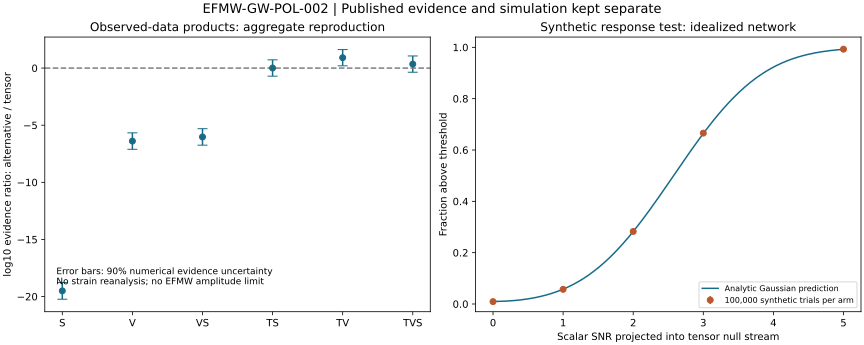

# Extra Gravitational-Wave Polarizations: Aggregate Evidence Reproduction, Synthetic Response Tests, and a Conditional EFMW Coupling Map

**Matthew Chenoweth Wright**  
Monolithic LLC — independent research  
**Study:** EFMW-GW-POL-002  
**Experiment executed:** 30 October 2026  
**Paper:** 31 October 2026, version 1.0  
**Status:** Computational methods and reproducibility report; not peer reviewed. Prepared with AI assistance. No new gravitational-wave detection or empirical validation of EFMW is claimed.

**Companion:** [Code, captured data, report, and reproducibility archive](research/efmw-gw-pol-002/README.md).

## Abstract

We reproduce the aggregate polarization-evidence calculation distributed with the LIGO–Virgo–KAGRA GWTC-5.0 tests of general relativity, verify a separate idealized detector-response simulation, and derive a conditional scalar-curvature interpretation for the frozen EFMW C1 action. The calculation reproduces all 36 rounded central-value and uncertainty entries in the source comparison table, and execution of the supplied numerical macro generator produces a byte-identical output. For tensor-plus-scalar versus tensor polarization, the combined Bayes factor is 1.0185246, providing essentially no preference between these hypotheses. A synthetic three-detector null-stream test uses 100,000 Gaussian noise realizations at each of five scalar injection strengths, with the same noise reused across strengths. Its noise-only threshold-crossing rate is 0.93%, consistent with the specified 1% per-template probability. All 32 executable consistency checks pass. In a restricted scalar-curvature sector, the EFMW candidate admits a conventional scalar-tensor coupling map, but neither this map nor the published aggregate evidences determines a compact-binary scalar waveform. The work establishes a reproducible calculation and identifies the missing physical and statistical inputs for a future EFMW-specific constraint.

## 1. Question and scope

The operational question is whether currently available polarization products can be connected to a specified, testable EFMW prediction. Three evidence levels must remain distinct:

1. **Observed-data products:** recombination of evidences already computed by another collaboration.
2. **Synthetic verification:** a known scalar response injected into ideal Gaussian detector noise.
3. **Conditional theory:** a local scalar-curvature map obtained from a restricted candidate action.

Reproducing the first does not repeat the collaboration's strain analysis. Passing the second does not show that nature contains the injected mode. Deriving the third does not demonstrate that the chosen fields, couplings, or background describe nature.

This study leaves existing EFMW and cosmology definitions unchanged. Its contribution is a traceable comparison and a statement of the conditions required for an observational test, rather than a new polarization discovery or a novel conformal-transformation theorem.

## 2. Inputs and provenance

The observational input is the official **LIGO-P2600410-v1** data release, specifically `POL.tar.gz` [1]. Its associated inspected manuscript is **LIGO-P2500781-v17**, dated **21 July 2026** [2]. The manuscript's peer-review status was not established in this study; its document-type designation is not treated as evidence of journal acceptance.

The archive contains eight files: three aggregate JSON inputs, a Python summary script, a plotting style, a README, a numerical LaTeX macro file, and a figure. The three input groups are pre-O4a, O4a, and the newly analyzed group represented by the O4b JSON. No calibrated strain, event-level likelihood, scalar-amplitude posterior, or per-event diagnostic dataset appears in this archive. The summary script refers to `event_diagnostics.py`, which is not included.

The theory input is the frozen **EFMW-LAGRANGIAN-C1** candidate [3], read at commit:

```text
83f9d2ec03e055c6cd09aa6359189161ad1571f6
```

The candidate and its physical-obligation document [4] were fetched at that immutable commit and matched against the inspected copies. The original experiment archive is retained unchanged with SHA-256:

```text
29a65c122fb377221d15de9d847d651a6799f06f32ba268ccf550b979ed4e37a
```

Source URLs, input hashes, the protocol, executable code, and machine-readable results are included in the companion archive. The downloaded collaboration manuscript is referenced rather than redistributed.

## 3. Aggregate evidence reproduction

Let \(Z_X\) denote the marginalized evidence for polarization hypothesis \(X\), and \(T\) the tensor comparator. We use

$$
B_T^X=\frac{Z_X}{Z_T},\qquad \ell_X=\log_{10}B_T^X.
$$

The independent implementation sums the three released aggregate log-evidence ratios. It combines their reported uncertainty half-widths in quadrature, matching the upstream convention. The uncertainty is numerical evidence-estimation uncertainty, not an interval for a physical coupling.

| Hypothesis \(X\) | Meaning | Reproduced \(\log_{10}B_T^X\) ± 90% half-width | \(B_T^X\) |
|---|---|---:|---:|
| S | Scalar only | −19.504735 ± 0.729979 | \(3.127987\times10^{-20}\) |
| V | Vector only | −6.389085 ± 0.719354 | \(4.082394\times10^{-7}\) |
| VS | Vector plus scalar | −6.027688 ± 0.718824 | \(9.382361\times10^{-7}\) |
| TS | Tensor plus scalar | 0.007972 ± 0.713019 | 1.018525 |
| TV | Tensor plus vector | 0.911054 ± 0.712961 | 8.148049 |
| TVS | Tensor plus vector plus scalar | 0.350081 ± 0.713198 | 2.239138 |

All 36 rounded central-value and error entries across the three source Table 6 rows agree. The upstream numerical macro output is reproduced byte-for-byte. The separate summation implementation agrees with the upstream aggregate calculation to the specified tolerance.

The relevant comparison for an *additional* scalar is TS against T. A scalar-only rejection cannot be substituted for that comparison. Here TS/T is essentially unity. Conversely, the modest positive TV result cannot be converted into a discovery significance from numerical integration errors alone. The manuscript treats the positive mixed-mode results as inconclusive [2].

Its effective-polarization construction assumes constant complex ratios between modes and uses GR-selected time–frequency regions. The amplitude prior for the complex ratios is uniform on [0,1], with uniform phase. Noise departures and a scalar waveform outside these assumptions can affect interpretation [2].

### 3.1 Why these numbers cannot yield an EFMW coupling bound

For a physical parameter \(\lambda\), an evidence is an integral,

$$
Z=\int \mathcal L(d\mid\lambda)\,\pi(\lambda)\,d\lambda.
$$

A single value of this integral does not recover the likelihood or the posterior shape. Consequently, it cannot specify a scalar-amplitude upper limit without additional information. In this case, even the parameter mapping from a catalog coefficient to a frozen EFMW source model is missing.

There is a second distinction. A product of event evidences with separate parameter integrals,

$$
\prod_i\int\mathcal L_i(d_i\mid\lambda_i)\pi_i(\lambda_i)\,d\lambda_i,
$$

is generally different from the evidence for one coupling shared by all events,

$$
\int\pi(\lambda)\prod_i\mathcal L_i(d_i\mid\lambda)\,d\lambda.
$$

The released aggregate products therefore cannot simply be relabeled as a common-coupling EFMW likelihood. Nuisance parameters, source-dependent charges, and selection assumptions would also have to be handled in that analysis.

## 4. Synthetic detector-response verification

The simulation is deliberately narrower than a catalog analysis. It uses three ideal, equal-noise Michelson detectors with fixed randomly generated orientations, a known sky direction, and a known unit-normalized real temporal template. The geometry is not the actual Hanford–Livingston–Virgo network. Gaussian noise is independent across detector channels. No glitches, calibration errors, sky search, time search, or waveform-bank search is modeled.

For orthogonal arm unit vectors \(u_I,v_I\), the detector tensor is

$$
D_I=\frac12(u_Iu_I^\top-v_Iv_I^\top).
$$

With transverse orthonormal vectors \(m,l\) and propagation direction \(n\), use

$$
e_+=mm^\top-ll^\top,\quad e_\times=ml^\top+lm^\top,
$$

$$
e_b=mm^\top+ll^\top,\qquad e_L=\sqrt2\,nn^\top.
$$

The response is \(F_I^A=D_I:e_A\). Since \(\operatorname{tr}D_I=0\), the long-wavelength responses obey

$$
F_I^L=-\sqrt2 F_I^b.
$$

This establishes response degeneracy for these conventions, not an assertion that breathing and longitudinal physical fields are identical.

Let \(F_T\) contain the two whitened tensor-response columns. Define

$$
P_T=I-F_TF_T^+,\qquad
w=\frac{P_Tb}{\|P_Tb\|},
$$

where \(+\) denotes the Moore–Penrose pseudoinverse and \(b\) the scalar response. If \(P_Tb\ne0\), the scalar statistic \(z=w^\top d\) removes the tensor contribution. With the stated Gaussian noise and a scalar injection of projected signal-to-noise ratio \(\rho\),

$$
z\sim\mathcal N(\rho,1).
$$

The two-sided threshold is \(t=\Phi^{-1}(0.995)\), giving nominal 1% per-template false-alarm probability. Its analytic detection probability is

$$
p_{\rm det}(\rho)=1-\Phi(t-\rho)+\Phi(-t-\rho).
$$

### 4.1 Executed results

The fixed seed is **20261030**. Each arm evaluates 100,000 noise realizations. The same realizations are reused across arms, so the results are correlated; this is not 500,000 independent noise draws.

| Projected scalar SNR \(\rho\) | Threshold crossings / 100,000 | Simulated fraction | Analytic fraction |
|---:|---:|---:|---:|
| 0 | 930 | 0.930% | 1.000% |
| 1 | 5,718 | 5.718% | 5.771% |
| 2 | 28,273 | 28.273% | 28.237% |
| 3 | 66,578 | 66.578% | 66.428% |
| 5 | 99,279 | 99.279% | 99.233% |

Every arm lies within the predefined five-binomial-standard-error tolerance around its analytic probability. For the null arm, the standard error is approximately 0.0315 percentage points, so 0.93% is about 2.22 standard errors below 1%. The tolerance is a numerical acceptance rule, not an observational significance criterion.

The tensor-annihilation residual norm is \(4.44\times10^{-16}\). The scalar response projected into the null direction is nonzero for the chosen geometry. A separate two-detector check confirms that, when the two tensor columns have rank two, they exhaust the two measurement channels and the unrestricted tensor-null projector vanishes. Waveform restrictions can permit additional comparisons, but those restrictions must be explicit.



*Figure 1. Left: recombination of published evidence products. Right: a separate idealized synthetic response check. The panels describe different kinds of evidence. Neither provides an EFMW-specific observational limit.*

## 5. Conditional map from C1 curvature couplings to scalar response

This section applies established scalar-tensor methods [5] to an explicit restriction of C1. It is an analytic derivation with numerical checks, not a Lean proof or an empirical result.

Take zero gauge fields and retain the scalar-curvature sector. In reduced Planck units \(M_{\rm Pl}=c=\hbar=1\), write \(x_a=\varphi_a/M_{\rm Pl}\), with couplings expressed in those units. Denote the curvature coefficient by \(F(x)\); this scalar function is distinct from the detector-response matrix in Section 4. The restricted action has the form

$$
S_J=\int d^4x\sqrt{-g_J}\left[
\frac12F(x)R_J-\frac12\delta_{ab}\partial_\mu x_a\partial^\mu x_b-V(x)
\right],
$$

where the C1 curvature terms give

$$
F=1-\sum_a\xi_ax_a^2-2\sum_ag_{Ea}x_a
-2\sum_{a<b}h_{Eab}x_ax_b.
$$

At a constant background \(x_0\), define

$$
q_a=\left.\frac{\partial F}{\partial x_a}\right|_{x_0}
=-2\xi_ax_{0a}-2g_{Ea}-2\sum_{b\ne a}h_{Eab}x_{0b}.
$$

For \(F_0>0\), the conformal transformation \(g_E=Fg_J\) gives the local scalar kinetic matrix

$$
K=\frac{I}{F_0}+\frac{3qq^\top}{2F_0^2}.
$$

This is a local field-space metric. A local normalization around the background does not establish a globally canonical field redefinition for an interacting multifield model [5].

### 5.1 Explicit matter-extension assumption

Frozen C1 is source-free. To interpret a source or detector, now **assume an additional matter action minimally coupled to the Jordan metric**. This is a declared extension, not an implicit property established by the original candidate.

Its Einstein-frame conformal factor is \(A=F^{-1/2}\). With local canonical kinetic normalization \(-\tfrac12(\partial\chi)^2\), the dimensionless coupling vector is

$$
\alpha=-\frac{1}{2F_0}K^{-1/2}q.
$$

Because \(q\) is an eigenvector of \(K\),

$$
\|\alpha\|^2
=\frac{q^\top K^{-1}q}{4F_0^2}
=\frac{\|q\|^2}{4F_0+6\|q\|^2}.
$$

The normalization is stated to prevent direct transplantation of limits using different scalar-tensor conventions. A numerical matrix inverse was compared with this closed form for 1,000 samples with \(F_0\in[0.5,2]\). The largest absolute discrepancy was \(5.55\times10^{-17}\). A separate finite-difference check of \(\nabla F\) had maximum error \(2.72\times10^{-11}\).

Positive kinetic eigenvalues in these samples do not establish stability of the full C1 theory. Potential stability, mass eigenvalues, gauge-curvature interactions, and the validity of an effective-field-theory truncation require additional analysis. The gradient check and the kinetic-matrix check are separate numerical families, not 1,000 fully specified stable cosmological solutions.

### 5.2 Linear breathing response and the decoupled limit

Assume a locally flat constant-scalar background satisfying the background equations, compatible vacuum energy, and a massless scalar perturbation in the relevant band. The scalar conformal contribution to the Jordan metric is

$$
\delta g^J_{\mu\nu}=-\frac{\delta F}{F_0}\eta_{\mu\nu},
$$

so its transverse breathing strain is

$$
h_b=-\frac{\delta F}{F_0}=-\frac{q\cdot\delta x}{F_0}.
$$

Thus \(q=0\) gives no **linear conformal breathing response in this limit**, even if scalar degrees of freedom exist. This does not address rolling backgrounds, massive longitudinal response, nonlinear scalarization, or nonzero gauge backgrounds.

For comparison with a catalog coefficient, one would need

$$
C_b(f)=\frac{h_b(f)}{h_+(f)}
=-\frac{q\cdot\delta x(f)}{F_0h_+(f)}.
$$

The missing quantity is the emitted and propagated \(\delta x(f)\), including the compact objects' scalar charges and boundary conditions. A nonzero curvature gradient alone does not establish nonzero radiation from a particular binary. The existence of an EFMW-labelled scalar therefore cannot be equated with an observable extra GW polarization.

## 6. Verification, independence, and limitations

The original run passed **32 checks**: 18 table-row checks, two upstream/independent-recombination checks, four detector-response checks, five injection-rate checks, and three coupling/gradient/kinetic checks. Each table-row check verifies a central value and its uncertainty, producing the 36 matched numerical entries.

The protocol was written after the published data had been inspected and before the simulation's first execution. It is a reproducibility protocol, not a preregistered discovery analysis. Its synthetic tests use known injected responses; recovery demonstrates implementation consistency under those assumptions, not independently discovered dynamics.

| Statement | Evidence status |
|---|---|
| Recombination of released aggregate evidence | Demonstrated computationally |
| Recovery rates for the specified Gaussian injection model | Demonstrated computationally, within stated tolerance |
| Restricted C1 scalar-curvature map | Conditional analytic result with numerical checks |
| Stability and viable source dynamics of full C1 | Unresolved |
| Extra polarization detected in observed strain by this study | Not established; no new strain search performed |
| EFMW-specific parameter bound | Unresolved; required waveform/likelihood mapping absent |
| Physical validation of EFMW | Not established |

No complete Monolithic Zoo execution, independent external replication, or formal proof of these calculations is claimed. The full published pipeline was not rerun. Bayes factors depend on hypothesis definitions and priors, and numerical evidence errors do not incorporate every noise or modeling uncertainty.

## 7. Next discriminating test

The next task is to freeze a physically consistent submodel before examining a target signal: numerical couplings, background, potential, matter action, mass spectrum, binary-source charges, waveform, and propagation. Derive the predicted detector strain from that model. A viable branch with \(q=0\) in the stated local limit should remain a null-response control.

The resulting waveform must then be tested against independent GR-plus-noise injections, calibration errors, glitches, and competing conventional scalar-tensor signals. A future analysis should freeze its event selection and global false-alarm calibration, including sky, time, and template trials, before unblinding. An EFMW-specific claim requires discrimination from those alternatives, not merely recovery of an arbitrary scalar injection.

Only after these obligations are satisfied should calibrated public strain, PSDs, and data-quality segments be used for a fresh common-coupling likelihood. An upper limit could then exclude a stated parameter region; a positive result would require robustness to systematics and independent replication.

## 8. Conclusion

EFMW-GW-POL-002 reproduces the available aggregate polarization products and verifies a bounded synthetic response calculation. The tensor-plus-scalar evidence ratio is essentially unity. The conditional C1 calculation identifies how a scalar-curvature gradient can enter a linear breathing response, and also identifies a decoupled limit. It does not supply a source waveform or an EFMW observational bound. The scientific outcome is a reproducible methods result and a precise statement of what must be derived before this proposed physical test can discriminate EFMW from existing theories.

## Reproducibility and attribution

Download the [unchanged experiment archive](research/efmw-gw-pol-002/EFMW-GW-POL-002-results.zip), verify the SHA-256 in Section 2, and extract it. From the extracted directory:

```sh
python -m pip install -r requirements.txt
python run.py
python build_report.py
```

The recorded environment uses NumPy 2.3.5, SciPy 1.17.0, and Matplotlib 3.10.8. The archive contains the exact Python/platform record, source hashes, protocol, original POL files, and results. This paper reports the executed 30 October run; manuscript preparation does not constitute a second independent experiment.

LVK data and software are credited to their originators and retain their stated CC BY 4.0 terms unless otherwise indicated. The archive's `ATTRIBUTION.txt` preserves the release-requested acknowledgment. This work is not an LVK result or endorsement. The C1 action is attributed to Matthew Chenoweth Wright; the conventional conformal framework is credited below. AI assistance was used for coding, calculation, source review, and writing; automated checks are not substituted for independent scientific review.

## References

1. LIGO–Virgo–KAGRA, **Data release for GWTC-5.0: Tests of General Relativity**, LIGO-P2600410-v1, official data release, `POL.tar.gz`. [Versioned record](https://dcc.ligo.org/LIGO-P2600410-v1/public).
2. LIGO–Virgo–KAGRA, **GWTC-5.0: Tests of General Relativity**, LIGO-P2500781-v17, manuscript dated 21 July 2026, Section 5 and Tables 5–6. Publication status beyond the inspected manuscript unconfirmed here. [Versioned record](https://dcc.ligo.org/LIGO-P2500781-v17/public).
3. Matthew Chenoweth Wright, **EFMW-LAGRANGIAN-C1 — frozen candidate**, version 1.0.0, frozen 13 October 2026; repository snapshot `83f9d2ec03e055c6cd09aa6359189161ad1571f6`. Proposed action, not empirical validation. [Pinned specification](https://github.com/enuminous/EFMW-Lagrangian/blob/83f9d2ec03e055c6cd09aa6359189161ad1571f6/candidate/CANDIDATE.md).
4. **Physical and mathematical obligations beyond the finite certificates**, same pinned repository. [Physical obligations](https://github.com/enuminous/EFMW-Lagrangian/blob/83f9d2ec03e055c6cd09aa6359189161ad1571f6/docs/PHYSICAL_OBLIGATIONS.md).
5. David I. Kaiser, **Conformal Transformations with Multiple Scalar Fields**, *Physical Review D* **81**, 084044 (2010), peer-reviewed article. [DOI: 10.1103/PhysRevD.81.084044](https://doi.org/10.1103/PhysRevD.81.084044); [associated preprint, arXiv:1003.1159](https://arxiv.org/abs/1003.1159).
