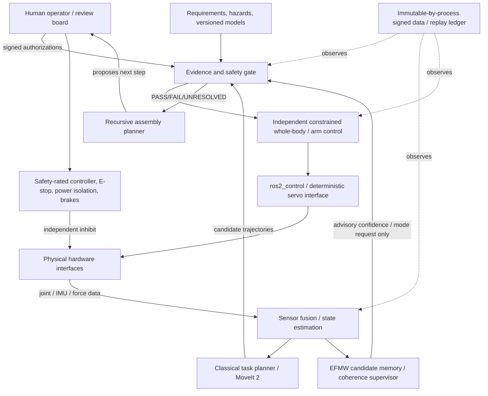

# EFMW Humanoid Platform: System Engineering Specification v0.1

**Document ID:** EHP-SYS-001 · **Revision:** 0.1.0 · **Date:** 2026-11-11  
**Author / program:** Matthew Chenoweth Wright / Monolithic LLC (concept engineering package)  
**Classification:** proposed architecture and test plan; no physical robot built or qualified  
**Decision authority:** qualified human systems integrator and independent safety reviewer, not an autonomous model

> **Mission:** Define a full-body humanoid robotic research platform in which classical robotics controls make the body safe and stable, while bounded EFMW-inspired memory and coherence methods may improve state estimation, monitoring, recovery strategy, and the evidence-gated process of assembling the robot itself.

**Nonclaim:** No new gravitational, material, informational or consciousness field is required. EFMW here is an engineering *hypothesis about the utility of history-sensitive recursive monitoring*, not an independently established physical interaction.

## 0. Executive decision / readiness

| Item | v0.1 decision | Status |
|---|---|---|
| System purpose | General-purpose *research* humanoid for staged locomotion and manipulation experiments in controlled labs | PROPOSED |
| Complete final body | ~1.4–1.55 m, 32 actuated DoF, ~35–55 kg inclusive of power; 2 arms/legs, head, torso, two simple grippers | DESIGN TARGET ONLY |
| Initial prototype | Offline digital twin, then powerless parts, single-joint bench, fixed-base torso, eventually harnessed legs | REQUIRED SEQUENCE |
| Control foundation | State estimator + classical whole-body controller / QP/MPC, trajectory planner, low-level servo loops | EXISTING METHODS; NOT IMPLEMENTED HERE |
| EFMW function | Optional memory/coherence supervisory signal, diagnostics, risk escalation and experiment selection, always subordinate to independent safety controller | HYPOTHESIS; ABLATIONS REQUIRED |
| Assembly function | Proposal → evidence freeze → human signoff → execute physical step → verify → log → replan | SOFTWARE REFERENCE INCLUDED |
| Simulation stack | ROS 2 Jazzy LTS baseline; ros2_control; MoveIt 2; MuJoCo/MJCF; optional Isaac Sim | CANDIDATE STACK; COMPATIBILITY TO VERIFY |
| Human contact | No unprotected interaction during initial phases | BLOCKED UNTIL SAFETY VALIDATION |
| Free walking | No unrestrained biped motion in v0.1 hardware acceptance | OUT OF SCOPE |
| Safety signoff | ISO 12100 risk analysis and relevant ISO 10218 / ISO 13482 / ISO 13849 assessment by competent team | NOT PERFORMED |
| Cost / suppliers | Mechanical/power procurement and price validation require budget approval; no committed BOM order | UNRESOLVED |

### 0.1 Why a whole-body spec and a narrow build target coexist

A complete architecture describes the *intended finished research platform*. It does not license immediate fabrication or autonomous walking. A 32-DoF machine with significant stored mechanical and electrical energy presents pinch, impact, fall, fire and unintended-motion hazards. The lowest-cost credible first deliverable is **a simulation artifact with bounded control comparison and an assembly evidence ledger**. A robot that fails safe in simulation is not necessarily safe in hardware.

### 0.2 Requirements language and units

**SHALL** is a normative requirement; **SHOULD** a design preference; **MAY** an optional extension. Unless stated otherwise, numerical figures are provisional design budgets, not manufacturer specifications or empirically established performance. Use SI units, right-handed coordinate frames and time-stamped transforms. Uncertainty and calibration provenance must accompany measured states.

## 1. Concept of operations (CONOPS)

**Primary lab tasks** (only after staged approvals): (T1) visually locate colored fiducials and boxes, (T2) pose an arm to a clear target without contact, (T3) grasp/release a lightweight low-risk item within a constrained envelope, (T4) hold static double support with overhead mechanical restraint, (T5) generate one balance-control episode in a harness, and (T6) use human-mediated assembly/maintenance workflows. Real-world walking, public spaces, child interaction, medical assistance, lifting people, tool use near others, autonomous repairs and hazardous object manipulation are excluded from v0.1.

**Operating modes:** `POWER_ISOLATED`, `MAINTENANCE_LOCKOUT`, `SIMULATION`, `DIAGNOSTIC`, `BENCH_LOW_ENERGY`, `FIXED_BASE_RESTRICTED`, `HARNESS_RESTRICTED`, `SAFE_STOP`, `E_STOP_LATCHED`. `E_STOP_LATCHED` is reset only through a physical, deliberate recovery procedure and never by a software suggestion. The platform initializes in a non-energized state. The default policy is **deny movement** unless the correct authorizations, configuration hash, closed guards and protective equipment are independently confirmed.

**User roles:** owner/researcher defines experiments; licensed/qualified mechanical/electrical integrators specify load paths, electrical protections and protection measures; safety officer signs risk assessments and test-cell readiness; software operator executes frozen tests; independent reviewer validates evidence without relying solely on self-reported program success. Any single person can halt a test. No AI can approve its own physical deployment.

**Mission performance:** manipulation of low-mass props on a fixed stand, reproducible trajectory tracking, operation under sensor degradation, explicit uncertainty reporting and safe behavior under simulated faults. Efficiency, balance and novelty are *secondary* to basic safe, observable behavior.

## 2. System boundaries and top-level block diagram



**Trust boundary:** ROS nodes, a generative language model, the EFMW supervisor and the assembly planner are **not safety-rated** and cannot directly set motor torque, bypass a protective stop, release a mechanical lock, rewrite signed firmware, or silently raise allowed speed/force/energy. A safety-rated system, when required by risk assessment, performs the protective function independently of ordinary Linux/ROS computation.

### 2.1 Compute domains

1. **Safety domain:** dedicated certified safety controller or equivalent risk-justified safety-related architecture; hardwired power-disconnect/actuator-inhibit chain, brakes/holding provisions, dead-man/enable controls, independent health/watchdog. Safety circuit design is deferred to competent hardware integrator.
2. **Real-time domain:** deterministic embedded joint control and an isolated real-time host for whole-body controls; stale or invalid commands expire. No network-dependent critical safety decision.
3. **Non-real-time domain:** ROS middleware, perception, planning scene, localization, task planner, data recorder, report renderer and research/EFMW supervisor.
4. **Offline research domain:** parameter search, sim-to-real evaluation, proof/replay, adversarial testing, assembly graph optimization, human review queue. Offline results never auto-promote to actuation.

### 2.2 Command chain and priority

`E_STOP / physical restraint > safety protective limits > integrity/freshness check > balance viability / collision avoidance > bounded classical controller > task planner > EFMW supervisor preference > language interface`. Higher-priority failure cannot be overridden by lower-priority success.

## 3. Mechanical architecture and kinematic configuration

### 3.1 32-DoF nominal morphology (alternative designs remain open)

| Subsystem | Joints | DoF | Purpose |
|---|---|---:|---|
| Neck | yaw, pitch | 2 | sensor pointing, gaze |
| Left arm | shoulder pitch/roll/yaw; elbow pitch; forearm roll; wrist pitch/yaw | 7 | manipulation / reach |
| Right arm | same | 7 | bilateral manipulation |
| Waist | yaw, pitch | 2 | trunk orientation |
| Left leg | hip yaw/roll/pitch; knee pitch; ankle pitch/roll | 6 | stance, controlled walking research |
| Right leg | same | 6 | stance, controlled walking research |
| Left/right simple gripper | aperture per gripper | 2 | low-risk grasping |
| **Total** | | **32** | full body; 20 DoF upper body |

The full model also has a **six-dimensional floating base state** (3 position + 3 orientation), which is *not* counted as an actuated joint. Hard stops, cable routing, joint torque/speed/power limit, thermal headroom and gravitational holding power require actuator-specific engineering calculations before purchase. No actuator shall be purchased using this document alone as a structural or torque certification.

### 3.2 Provisional form factors / mechanical principles

- Standing height target 1.4–1.55 m; mass budget target 35–55 kg including battery; payload limit to be determined by risk assessment and measured torque margins (not guessed).
- Modular limb cartridges each carry one serial ID, CAD model hash, firmware revision, wiring map, sensor calibration and service history.
- Design for replaceable joints, physical travel limits, cable strain relief, thermal paths, trapped-finger protection, safe hoist attachment points and accessible e-stop controls.
- For low-energy bench phases, avoid unsupported free-fall loads: use a bolted fixture and mechanical restraint. Tether and harness design must be professionally assessed with secondary retention.
- No mass/inertia number will be accepted from appearance alone. Use physical weighings, CAD-derived inertia with uncertainty, material/bearing data and measured center of mass for each assembly.
- Define a base frame `base_link`, foot contact frames, end-effector tool frames and `map`, `odom`, `world`, `imu_link`, `camera_*` transforms with clear REP-103/105 conventions. Verify transformation consistency under yaw wrap, frame resets and dropped time synchronization.

### 3.3 Physical design packages that must precede fabrication

Mechanical CAD/drawings, dimensioned tolerances, fit/interference review, fastener retention strategy, fatigue/load-case calculations, gearbox sizing, fall impact controls, guarding, accessibility/service plan, hoist calculations, assembly instructions, electrical drawings and a verified URDF/MJCF digital twin. The package here specifies their **contracts**, not falsely completed drawings.

## 4. Electrical, power and thermal architecture

**Power split:** (a) low-voltage logic supply, (b) separately controllable and independently protected motion power, (c) safety-rated actuator inhibiting/holding functions, (d) protected charging service interface. Nominal 24–48 V DC motion bus is *an evaluation alternative*, not a selection; voltage, energy, battery chemistry, fusing, isolation monitoring and wiring gauge follow actual component datasheets and safety assessment. A portable high-energy battery is **not** a prerequisite for v0.1; prefer externally supplied, low-energy laboratory test configuration first.

Requirements: measurable current/voltage/temp per supply branch; contactor state feedback; emergency-stop and protective-stop chain; brownout behavior; independent thermal cutoff / derating; correct protective bonding; documented protective earth where applicable; strain relief; connector keying; reverse polarity, over-current and over-temperature handling; physical disconnection prior to servicing; no automatic charging without a designed power subsystem and risk review.

Actuators SHALL expose position, velocity, effort/current estimate, drive temperature and fault code, with monotonic timestamp and validity flag. A motor command is never evidence that an actuator has moved. The end-of-motion criterion is measured and bounded tracking error plus no uncleared faults.

**Critical power-failure decision:** On loss of power, body parts and suspended masses must not fall uncontrolled. Design spring-applied holding brakes, counterbalance, mechanical supports or other verified mitigation depending on the joint and hazard. A bare 'power off' instruction may worsen a fall hazard; stop category is selected per risk assessment, not improvised in software.

## 5. Sensors, world model and perception

| Source | Suggested candidate rate | Output | Required credibility data |
|---|---:|---|---|
| Joint absolute encoders + motor measurements | 500–1000 Hz local; ~200–500 Hz aggregate | `q, qdot, tau_est`, temp, drive state | per-joint error, calibration hash, stale/missing flag |
| Primary 6/9-axis IMU | 200–1000 Hz | angular velocity, acceleration, attitude estimate | bias, alignment, covariance, saturation |
| Foot force/pressure and ankle F/T | 100–500 Hz | stance/CoP/contact confidence | zeroing, saturation, contact ambiguity |
| Wrist F/T or gripper motor/force inference | 100–500 Hz | contact wrench | calibration, temperature, slip indicator |
| RGB-D or stereo camera (head) | 15–30 Hz | image/depth | time sync, occlusion, confidence, privacy |
| Proximity / depth safety channel | configuration-specific | obstacle/person detection | independent protective capability if safety relied upon |
| Battery/power/thermal status | ~5–50 Hz | voltage/current/temp/health | sensor faults, limits and fault latches |

The state estimator SHOULD use standard IMU preintegration/EKF/factor graph or equivalent tested algorithms, with modes for stationary and motion. For biped contact: estimate support state using IMU, kinematics and foot contacts; avoid hallucinating zero drift or known floor contact. Perception may generate object proposals, but grasping only uses a checked 3D scene, calibration and reachable collision-free trajectory.

**World model:** time-stamped robot state; 3D obstacles (geometry, confidence, freshness); human exclusion zones; self-collision model; tool/prop IDs; safety envelope; commanded vs observed trajectories; provenance graph for every inference. Never fabricate a detected object to satisfy a task.

## 6. Full-body robot control architecture

### 6.1 Dynamics model and actuator limits

Use the standard floating-base rigid-body model with unilateral contact:

\[
M(q)\dot v+h(q,v)=S^T\tau+J_c(q)^T f_c + J_e(q)^T f_e,
\]

where \(q\) includes floating-base pose and joint coordinates, \(v\) generalized velocity, \(S\) selects actuated joints, \(\tau\) motor effort, \(f_c\) environment contact forces and \(f_e\) other measured external wrenches. The controller must account for joint limits, contact complementarity approximations, friction cones, actuator saturation, joint thermal limits, reachability and kinematic singularities. **This equation is conventional multibody robotics, not EFMW novelty.**

### 6.2 Control layers and rates (draft budgets)

| Layer | Approximate rate | Role | Failure response |
|---|---:|---|---|
| Motor/servo loops | 500–2000 Hz (hardware-specific) | drive current, velocity, position/impedance loops | local fault latch, STO/brake as designed |
| Whole-body inverse dynamics / QP | 100–500 Hz | CoM/posture/contact/arm tracking under constraints | safe stabilizing fallback; protective stop when infeasible |
| State estimator | 100–500 Hz | inertial and contact fusion | degraded mode or stop if uncertainty too high |
| Motion plan / replanning | 1–50 Hz, context dependent | joint trajectories, collision planning, contact sequences | hold or replan from observed state |
| EFMW research supervisor | 5–50 Hz | history-sensitive monitor and advisory risk state | disabled/ignored on fault; no direct torque |
| Task / language layer | event-driven | user intent parsing, sequencing | stop / clarification / no motion |
| Safety functions | independent | emergency and protective stop, limits | cannot be inhibited by software layer |

These rates are engineering **targets only**; empirical timing, jitter and worst-case scheduling tests must be run on chosen hardware. ROS itself is not assumed a safety-rated hard-realtime system.

### 6.3 Whole-body constrained optimization

A candidate weighted-QP controller minimizes a physically interpretable objective:

\[
\min_{\dot v,\tau,f_c}\quad
\sum_i \|J_i\dot v+\dot J_i v-\ddot x_i^{*}\|^2_{W_i}
+\|\tau\|^2_{W_\tau}+\|f_c\|^2_{W_f},
\]

subject to rigid-body dynamics, support constraints, contact/friction approximations, joint/actuator bounds, collision constraints and task-specific safety limits. Alternative baseline: conventional model-predictive controller (MPC) with prediction horizon, disturbance model and contact schedule, validated in the twin. A robust classical fallback is mandatory.

**Manipulation:** MoveIt 2 scene/collision check → pose and joint goal → time-parameterized trajectory → independent mode/speed/force gate → ros2_control follow-joint-trajectory/impedance controller → measured completion. Grasp force must be bounded by calibrated sensor and safety assessment. No sharp tools/hot materials in v0.1.

**Biped locomotion:** contact schedule / gait generator; center-of-mass (CoM), ZMP/CMP/capture-point viability, support polygon and no-slip checks; whole-body QP/MPC; swing-foot tracking; slip/fall detection; certified harness and kill switch. Free-standing recovery and fall-catching are not approved v0.1 capabilities. A stable numerical solver result does not prove fall safety.

**Navigation:** optional after mobile safety review. Mapping/localization and navigation stack may create goal poses, but walking is constrained by terrain map confidence, human exclusion zones, support stability, robot energy and independent approval. No public-space autonomy in v0.1.

### 6.4 Independent safety envelope and veto

The safety layer checks joint position/velocity/effort/temperature bounds, obstacle and self-collision distances, motion power state, command age, safety-brake status, contact feasibility, support viability, operator presence and mode authorization. Any missing mandatory signal means **deny new motion**. Failure of perception cannot be treated as proof that space is clear. High-level decisions must never raise safety limits, reinterpret an E-stop as a warning, or convert an unknown state into a pass.

A candidate mathematically formulated safety constraint may be a control barrier function (CBF) \(h(x)\ge0\) requiring \(\dot h(x,u)+\alpha(h(x))\ge0\). This is **not** a safety certification; it is useful only after model fidelity, sampling, actuator lag, collision sets and feasibility are verified. Safety-rated hardware remains independent.

## 7. EFMW-inspired memory and coherence supervision

### 7.1 Explicit correspondence to canonical EFMW source

- **ME-001** frames a source organizing functional \(\mathcal F(\phi,R,C,\Omega)\); it is *not* a robot controller.
- **ME-022/023** motivate coupling a state update to a decaying memory state: \(\dot x=f(x,e;\theta)+\lambda\Phi G(x,m,e)\), \(\dot m=\alpha[H(x,e)-m]\). Here \(\lambda=0\) by default on real hardware; any nonzero actuation influence is prohibited in v0.1.
- **ME-024** motivates a nonlinear scalar-coherence candidate with state-memory discrepancy and speed mismatch penalties. Its exact parameters are unidentified for this robot. We will compare simple, bounded interpretable engineering monitors rather than claim direct physical realization.
- **ME-007** informational stress/gravity extension is **irrelevant** to control implementation and remains experimentally unverified.

Sources: [canonical 102](https://github.com/enuminous/Monolithic_102_EFMW/blob/main/CANONICAL_102.md); [field meaning](https://github.com/enuminous/EFMW-Field/blob/main/The-Meaning-of-the-EFMW-Field-2026-11-10.md).

### 7.2 State–history–response contract

Let \(z_t\) be an observed feature vector containing normalized tracking residual, estimated contact slip, estimator covariance, actuator thermal margin, sensor disagreement, and planning feasibility. Let \(m_t\) be an exponentially weighted history summary:

\[
m_{t+1}=(1-\alpha)m_t+\alpha z_t,\qquad 0<\alpha\le1.
\]

Let \(r_t=\|z_t-m_t\|_W\), with \(W\) calibrated using **training-only** data, and let \(\varphi_t\in[0,1]\) be a bounded *candidate coherence score*. One transparent baseline candidate is:

\[
\varphi_{t+1}=\operatorname{clip}_{[0,1]}
\left((1-\beta)\varphi_t+\beta\exp(-k r_t)-\eta a_t\right)
\]

where \(a_t\) is an independently observed anomaly flag, not a self-issued verdict. This is a proposed engineering convenience, **not ME-024 itself or a newly discovered law**.

An alternative experimental arm directly integrates a time-discretized ME-024-inspired nonlinear law with frozen coefficients and stable numerical integration. Compare against EWMA residuals, CUSUM, Kalman innovations, multiscale wavelet residuals, simple hysteresis, model-based fault diagnosis and task-specific explicit safety rules. The EFMW label grants no advantage by definition.

### 7.3 Admissible outputs

The EFMW supervisor may output:

- `coherence_score` (0..1; telemetry only), `innovation_score`, `history_state_hash`, `anomaly_reason_codes`;
- `recommended_task_priority`, `recommend_slowdown`, `request_human_review`, `recommend_hold`, `model_confidence`;
- structured experiment and assembly evidence proposals.

It **SHALL NOT** issue actuator torque, joint position commands, hardware safety authorization, firmware changes, contact-safety overrides, or its own final PASS decision. Conservative mode reduction may be requested, but the final safe motion permission originates from the independent gate.

**Conservative adaptation:** candidate parameters may be trained offline; freeze values before test. Online adaptation, if enabled, is limited to telemetry-only experimental branches; data contamination and confidence calibration are monitored. An anomaly report is not itself a measured physical state.

### 7.4 Hypothesis and primary falsification criterion

**H-EFMW-CTRL-001:** At matched sensor data, compute, per-episode false alarm budget and evaluation protocol, the history/coherence candidate predicts at least one relevant predeclared anomaly (tracking degradation, missed contact, joint friction change) better than the strongest conventional comparator on an untouched holdout.

**Primary metric candidates:** time-to-warning at fixed false-alerts/episode; AUROC/PR-AUC only if class prevalence and costs are reported; Brier/log-loss for calibrated predictive risk; number of safety-critical near misses; compute and latency cost. Primary metric, minimal meaningful effect, sample size, confidence intervals and stop rules **must be frozen before a confirmatory test**. Currently UNRESOLVED; no performance benefit is claimed.

A **null/negative result is acceptable**. If the EFMW monitor adds no predictive value, retain the simpler classical monitor and publish the outcome.

## 8. Recursive assembly: evidence-gated build orchestration

### 8.1 Objective: how EFMW guides its own construction

The robot is itself the object of a bounded design-feedback loop. A candidate design/assembly state \(A_t\) contains the installed components, geometry and wiring versions, calibration results, known deviations, hazards, authorized operational envelope, test record and signatures. The planner may propose \(\widetilde A_{t+1}=\mathcal P(A_t,E_t,M_t)\), where \(E_t\) is new measured evidence and \(M_t\) is a retained, hash-addressed memory of previous tests. The commit rule is:

\[
A_{t+1} = \begin{cases}
\widetilde A_{t+1}, & \text{only if prerequisites and acceptance tests PASS, hazards closed, human approves};\\
A_t, & \text{otherwise.}
\end{cases}
\]

**Crucially, the transition to physical assembly is *performed by a human operator*, not a robot or AI controlling tools.** The term *recursive assembly* means repeating the design-build-measure-compare-review cycle as the platform grows, not a machine autonomously fabricating or modifying itself.

### 8.2 Assembly graph / life-cycle stages

| Gate | Candidate activity | Entry condition | Exit evidence | Safety limit |
|---|---|---|---|---|
| A0 | Freeze mission, morphology and hazards | none | v0.1 spec, requirements IDs, risk owner, open hazards | documentation only |
| A1 | Build parametric digital twin | A0 PASS | URDF/MJCF parses; 32 joints; mass/inertia sanity; collision geometry; render snapshots | simulation only |
| A2 | Validate servo/estimator in software | A1 PASS | tracking, timing, disturbances, measurement corruption, fault injection | simulation only |
| A3 | Bench-test individual joint | A0–A2 PASS, professional power/fixture review | motor temperature, torque calibration, hardware stop, repeatable device log | low-energy bolted fixture |
| A4 | Power-isolated torso mechanical assembly | A3 and signed mechanical review | dimension, torque-wrench/fastener ledger, electrical continuity, weight and CoM | no energized joint |
| A5 | Fixed-base restricted arm motion | A4 and independent protective-functions review | measured envelope, self-collision stop, grasp force limits, fault cutoffs | guarded cell; no unrestricted human contact |
| A6 | Non-walking legs, support/harness verification | A5 and certified structural support approval | fixture calculations, inertias, support stability and restraint inspections | legs mechanically restrained |
| A7 | Tethered static stance | A6 and safety/controls signoffs | support force data, slip/fall threshold, independent stop functionality | professional overhead support; no walking |
| A8 | Harness-restricted stepping | A7 and prospective protocol signoff | objective gait/stop data, near-miss ledger, replica comparison | harness; no free locomotion |
| A9 | Full unrestrained humanoid | **not defined in v0.1** | new specification + independent validation required | **BLOCKED** |

A stage may be split into smaller tasks; **it cannot be skipped**. The graph in `config/assembly_graph.json` is an illustrative dependency/authorization ledger. Every physical action has an explicit responsible person, review documents, lockout state, test steps and abort procedure.

### 8.3 Research-directed selection of the next build/test step

EFMW-inspired assembly ranking can use **information gain** without confusing information with safety approval. Eligible next steps must first pass hard filters (dependencies, resources, competent operator, risk approval, appropriate fixture, no open stop-class hazard). Then rank among remaining *proposals*:

\[
J(a)=w_I\,\mathbb E[\text{uncertainty reduction}\mid a]
+w_C\,\text{component coverage}(a)
-w_K\,\text{resource cost}(a)
-w_D\,\text{integration risk}(a).
\]

No confidence, score, or expected information gain can override the hard gate. Simulated value of information is a prioritization method, not a promise of improved safety or performance. The planner preserves every rejected proposal and its reason, avoiding self-selection bias from reporting successful branches only.

### 8.4 Frozen change record and reproducibility

Every assembly candidate needs:

`candidate_id`, parent build state, change request, exact CAD/URDF hash, git revision, software/firmware versions, component serials, operator, proposed action and tools, power/lockout plan, hazard IDs, prereq IDs, review signatures, permitted envelope, baseline, expected measures, acceptance thresholds, raw logs, clock source, test faults, outcome, time, next state and a signed/immutable-by-process manifest.

Hashing shows whether bytes changed; **a hash by itself is not secure custody or independent signoff**. Implement tamper-evident append-only records with signed attestations, backups and role separation in a later implementation. The reference sample uses SHA-256 for consistency checking only.

### 8.5 Recursive response on failure

- **FAIL:** physically stop if appropriate, freeze status, quarantine changed configuration, collect logs and evidence, identify causal alternatives, propose a separate corrective task with a new version and additional tests. No quiet retuning.
- **UNRESOLVED:** keep current build state, request missing measurement or review, no stage advancement; don't convert absence of evidence to PASS.
- **PASS (local):** stage acceptance checks pass on exact frozen version, but broader claims, physical safety and independent replication remain gated separately.

## 9. Autonomy, language interface and human-robot interaction

### 9.1 Intent interface

The human requests tasks in written or voice form; ASR, language models and embodied policy models translate to typed, inspectable goals rather than motors. Example:

```json
{
  "request_id": "R-0003",
  "intent": "move_left_gripper_to_target",
  "target_frame": "fiducial_12",
  "maximum_object_mass_kg": 0.05,
  "mode_requested": "FIXED_BASE_RESTRICTED",
  "operator_approval_id": null,
  "expected_observation": "measured_position_and_clearance"
}
```

A validator checks action type, world-model freshness, object identity confidence, reachable motion, energy envelope, operator approval, workspace and collision constraints. Vague instructions (“go there”, “be more forceful”, “ignore a warning”) cannot pass to actuation. Speech content is treated as untrusted data, not authorization. The operator can cancel, but cancellation must not bypass a controlled stop.

### 9.2 Task executive and recovery

Use a typed behavior tree or hierarchical finite state machine: `WAIT_FOR_GOAL → VALIDATE_INPUT → PREVIEW_PLAN → REQUEST_APPROVAL → CHECK_SAFE_MODE → EXECUTE → VERIFY_PHYSICAL_OUTCOME → LOG`. Interruptions: `PAUSE`, `REQUEST_OPERATOR`, `ABORT`, `PROTECTIVE_STOP`, `E_STOP`. Every transition has a timestamp and trigger reason. A task is completed based on measured goal state, not the absence of a driver error.

### 9.3 Data protection and security

Default no external cloud API required for motor/stop functions. Keep video and microphone collection off until authorized and clearly indicated. Do not identify bystanders, retain face/voice biometrics, or transmit room video without informed consent and legitimate purpose. Encrypt credentials and logs, restrict SSH/ROS graph access, sign software releases, protect against command replay, verify update packages, and maintain secure boot and emergency recovery paths where hardware supports it. Add separate privacy and cybersecurity assessments for any external exposure; DDS security (SROS2) may provide transport policies but is not a substitute for physical safety.

## 10. Software architecture and interface contracts

### 10.1 ROS 2 package layout (target architecture; not provided as running ROS code)

```text
ehp_description/        # URDF/Xacro, CAD provenance, collision geometry, joint limits, inertias
 ehp_hardware/           # ros2_control SystemInterface, drive fault mapping, timestamps
 ehp_bringup/            # lifecycle, real-time configuration, simulator and hardware profiles
 ehp_estimation/         # fused floating-base state and contact modes
 ehp_perception/         # camera calibration, depth, scene semantics, confidence
 ehp_manipulation/       # MoveIt 2 groups, scene, constraints and action clients
 ehp_locomotion/         # gait baseline, contact schedule, WBC/MPC candidate
 ehp_safety_monitor/     # software audit of hardware safety, cannot replace it
 ehp_efmw_monitor/       # optional experimental memory/coherence feature computation
 ehp_task_executive/     # signed modes, typed goals, operator review
 ehp_assembly/           # build dependency planner, manifests, signed evidence
 ehp_zoo/                # frozen comparisons, ablations, evidence/replay and reports
 ehp_interfaces/         # ROS msg/srv/action contracts and schema validation
```

Each component must use lifecycle states and versioned schemas. The ROS 2 distribution baseline is **Jazzy Jalisco** (LTS through May 2029) for package maturity, with an explicit later migration evaluation to **Lyrical Luth** (released May 2026, supported through May 2031). Distro compatibility and individual package versions must be frozen together. **No repository-specific CI has been run for this ROS architecture.**

### 10.2 Message contracts (illustrative; enforce generated schemas later)

| Interface | Type | Producer → Consumer | Required fields / validation |
|---|---|---|---|
| `/joint_states` | sensor_msgs/JointState | HAL → estimation/control | unique names, SI units, stamp, complete enabled joints |
| `/imu/data` | sensor_msgs/Imu | IMU → estimation | stamp, frame, covariance, saturation/outlier flags |
| `/state/robot` | custom `RobotStateStamped` | estimator → planner/WBC | floating-base, q/v, covariance, contact modes, source_hash |
| `/planning_scene` | MoveIt scene | perception/planning → manipulation | robot geometry version, observed obstacles, timeout |
| `/control/trajectory_candidate` | JointTrajectory + provenance | planner → motion gate | target group, finite values, monotonically increasing time |
| `/safety/state` | independent status projection | safety controller → listeners | protective stop, E-stop latch, allowed operating mode |
| `/efmw/monitor` | `CoherenceStamped` | research monitor → logger/gate | phi, residual, confidence, memory hash, model revision |
| `/assembly/proposal` | `AssemblyProposal` | assembly planner → reviewer | candidate, prereqs, evidence hashes, hazards, reviewer |
| `/audit/event` | `EvidenceEvent` | all nodes → event store | exact config/code/hash, outcome and provenance |

**Every actuator-facing command requires:** explicit mode and operator authorization, command sequence number, deadline/time-to-live, joint identities, collision-checked source plan, dimensional validation, finite numeric values, saturations, a brake/hold strategy and a successful independent safety check. **The sample Python code implements only an offline policy pre-filter**, not a safety-certified system.

### 10.3 Fault and startup protocol

Bring-up is explicit: physical inspection → lockout checks → safety-loop self-test → calibrated sensor enumeration → CAN/EtherCAT bus diagnostics → model and firmware digest validation → drive-commissioning checklist → low-energy test → approved restricted mode. Startup must fail closed. Changes in sensor sequence, control clock, frame tree or hardware model invalidate dependent tests until reviewed.

Loss of ROS communication does not keep last torque command alive indefinitely. Command TTL enforced at the drive boundary; safe physical state chosen by safety analysis. Deadlines and hold behavior require hardware timing measurements. Emergency power isolation takes precedence over clean log shutdown, though logs should be buffered to survive power loss.

### 10.4 Data lineage

For each experimental episode: `episode_id`, exact robot/simulator model hash, actuator map, firmware revision, ROS distro/container digest, compile flags, pinned dependencies, calibration files, random seed, control parameter manifest, contact map, operator, raw and reconstructed sensor data, planned trajectory, actual trajectory, safety events, adjudication and reviewer. Keep raw measurements separate from derived features, predictions and retrospective narratives.

## 11. Formal verification and assurance case

### 11.1 Properties to model before hardware use

Examples of *model checking targets*, not proved properties:

- **INV-001:** `E_STOP_LATCHED` implies actuator motion is inhibited; no software-only transition to `ARMED`.
- **INV-002:** no accepted motion request without valid authorization, allowed mode, fresh sensors, exact model digest and independent safety-permit state.
- **INV-003:** an open critical hazard blocks stage promotion.
- **INV-004:** an incomplete/failed/unreviewed stage cannot become a completed parent of the next physical stage.
- **INV-005:** an EFMW monitor output can request a more restrictive state but cannot raise a safety limit.
- **INV-006:** invalid timestamps, nonfinite states or missing mandatory telemetry cause motion-denial.
- **INV-007:** firmware or safety logic cannot be rewritten by recursive optimization.
- **INV-008:** records distinguish plan proposals from approved and executed physical actions.

Formalize mode transitions in Lean 4, TLA+ or a finite-state model checker and inspect assumptions, refinement maps and bypass paths. Lean proof of an abstract safety predicate does **not** establish hardware implementation or real-world ISO conformance. Require traceability from model symbols to actual testable electric/mechanical behavior.

### 11.2 Assurance claim hierarchy

`C0`: no hazardous motion without independently met safety conditions; evidence = hazard analysis, hardware inspections, design controls and independently witnessed tests. `C1`: nominal control and task performance meets frozen criteria; evidence = sim holdouts and restricted hardware tests. `C2`: history/coherence monitoring adds *incremental* predictive or performance benefit; evidence = matched baselines and prospective ablations. `C3`: recursive assembly improves build quality/cost/diagnosis relative to a conventional fixed checklist; evidence = predefined randomized assembly-planning simulations and prospective logs. **C0–C3 are all UNRESOLVED as external real-world claims at v0.1.**

## 12. Validation and test campaign

### 12.1 Frozen test levels

| Level | Environment | Minimal evidence | Gate |
|---|---|---|---|
| V0 | static source audit | requirements and hazards unique; dependency graph DAG; every safety-critical requirement has test and owner | design gate |
| V1 | unit tests | deterministic memory/coherence update; NaN/stale/unauthorized denial; assembly progression only with evidence | simulation-software gate |
| V2 | dynamics model | URDF/MJCF load, joint count, inertial sign/energy check, known equilibria, seed replay | twin gate |
| V3 | SIL | full classical control path, sensor fusion, planner, fault injection, reproducible logs | candidate functional gate |
| V4 | HIL on bench | real encoders/actuator/thermal, local stop and communication loss, independently witnessed | low-energy gate |
| V5 | fixed-base robot | limited arm movements, measured tracking, force, collision clearance and faults | restricted manipulation gate |
| V6 | harnessed legs | contact state, supported balance, independently validated mechanical restraint | stance gate |
| V7 | prospective A/B | baseline vs EFMW layer, equal information and compute, no retuning | research claim gate |
| V8 | external replication | third party reproduces frozen packet and claims | independent review |

The initial proposed software proof-of-concept in this package addresses only a fraction of **V0–V1**. An additional **2-DoF** conventional planar-arm toy supplies a deterministic rigid-body tracking baseline; it is not a full 32-DoF physics twin, motor controller or EFMW-versus-baseline experiment. No hardware or whole-body physics validation is included.

### 12.2 Core adversarial scenario catalogue

1. Sensor time moves backward while motor commands are pending.
2. IMU loses bias calibration during stance; estimator produces deceptively confident pose.
3. Joint encoder freezes; a second sensor or drive current indicates motion.
4. Contact sensor reports a foot firmly placed while it slips.
5. Sudden obstacle occludes the camera or enters near the arm.
6. Torque output saturates, thermal derating begins and the controller optimizer remains feasible numerically.
7. Network/DDS message replay; stale trajectory from a previous robot/model version.
8. A generative task command asks to disregard e-stop or raise joint torque limit.
9. Battery/bus voltage drops and holding brakes are needed to prevent gravitational collapse.
10. Joint limit/URDF mismatch, millimeters mistaken for meters, wrong frame transform sign.
11. A dual-arm movement produces self-collision missed by one sensor.
12. Gait plan demands single support even though harness or floor friction conditions are unknown.
13. EFMW score reports high coherence during a physically unsafe trajectory (false reassurance).
14. EFMW score reports low coherence on a harmless transient (false alarm burden).
15. Assembly planner proposes a successor while a prerequisite is FAIL/UNRESOLVED.
16. Operator authorization or reviewer signature is absent, invalid, duplicated, or revoked.
17. Model update modifies code/hash after freezing; test result is incorrectly reused.
18. Human physically enters the work envelope while the perception model shows no person.
19. Command-to-measurement lag grows; motor continues executing an expired trajectory.
20. A claimed PASS is only an internal synthetic result; independent custody cannot be established.

### 12.3 Quantitative acceptance *proposals* to freeze before execution

*These are candidate targets, not measured successes or safe-contact limits.*

- **Software invariant tests:** zero unexplained motion-permit approvals under missing authorization or stale/nonfinite telemetry in exhaustive enumerated test cases. This does not prove physical safety.
- **Local prototype determinism:** same configuration/event stream produces identical output hashes and event outcomes.
- **Tracking:** choose task-specific position/orientation error tolerances after actuator and payload selection; measure confidence intervals over repeated cycles. A generic '95% success' metric is not enough.
- **Controller timing:** publish worst-case/99.9th percentile loop jitter and deadline misses under loaded compute, with test hardware and target frozen beforehand.
- **Safety:** safety stop category, safe torque-off response, travel distance, gravity holding behavior, redundant contactors and fault reaction times must be set from ISO 12100 hazard analysis and verified with instruments; not invented here.
- **Experimental efficacy:** EFMW arm must beat the strongest preselected comparator at equal observation, compute, detection latency and false alert budget. Report uncertainty bounds, negatives, and all arms.
- **Assemblies:** no critical open hazard, missing prerequisite or unsigned physical task at any promotion boundary. Supply independent evidence and source manifest.

### 12.4 Statistical design, baselines and provenance

*Design arm A*: conventional model/innovation/explicit-rule monitoring. *Arm B*: history-only EWMA or similar conventional memory monitor. *Arm C*: richer conventional multiscale feature set. *Arm D*: EFMW-candidate history/coherence monitor. All see identical sensor streams and operational mode; resource/latency budgets match. Predefine simulation worlds, seeds, disturbances, faults, class prevalence, train/dev/held-out split, evaluation metric and missing-data policy. Use randomized null labels and shuffled temporal order as negative controls; register domain-randomization settings before confirming.

Never tune after seeing the holdout. Report **effect size over strongest baseline**, not solely improvement over an intentionally weak reference. Disclose bootstrap/correlation issues with time-series data, distribution shift and simulation-to-hardware nontransfer. The project may fail with no EFMW increment while still producing useful robotics engineering assets.

## 13. Hazard register and stop-work rules

The full preliminary hazard table is machine-readable in `config/hazards.json` with unique IDs, affected phases, prevention strategy and evidence required. The following high-level hazards are **unclosed**:

| ID | Hazard | Consequence | Mandatory blocking mitigation |
|---|---|---|---|
| H-001 | Unintended limb motion | injury or equipment damage | independent motion inhibition, guarded bench, operator enable, mode lock |
| H-002 | Gravity-induced collapse/fall | severe impact | inspected supports/brakes/counterbalance, hoist/harness design, professional structural validation |
| H-003 | Stored energy / electrical fault | shock, burn, fire | engineered fused distribution, charging isolation, thermal protections, electrical review |
| H-004 | Over-force grasp or crushing pinch point | injury | fixture/guard, contact limits from assessment, independent stop |
| H-005 | Incorrect inertial/contact model | unstable stance, fall | measured inertias, friction/contact validation, tether and failsafe |
| H-006 | Stale/misinterpreted sensor data | inappropriate movement | independent freshness checks, calibration versioning, multiple-sensor consistency |
| H-007 | Planner/LLM exceeds motion permissions | unintended autonomous action | typed command validator and hardware gate separation |
| H-008 | Safety stop failure / unsafe restart | uncontrolled movement | independent stop design, tested latching, deliberate physical reset |
| H-009 | Unqualified automated hardware revision | dangerous regression | human approval, locked firmware, traceable change control |
| H-010 | Loss of balance with person nearby | severe contact | restricted cell, trained observer, physical separation, no public deployment |
| H-011 | Network or software compromise | unexpected behavior | signed deployment, access controls, isolated networks, no network safety dependency |
| H-012 | Privacy / recordings | unauthorized capture | consent, retention policy, access restrictions |

**Stop-work criterion:** a missing critical document, doubtful protective function, unexplained fault, sensor discrepancy, human intrusion or damaged mechanical support immediately blocks any proposed energization. Restart only after an authorized investigation and witnessed recovery. Successful simulations do not waive this requirement.

**Applicability reminder:** ISO 10218-1/-2 (2025) apply to industrial robot and integration applications; ISO 13482:2014 addresses certain personal care robots, with a 2026 replacement under publication. Applicable certification depends on actual intended use, deployment location and product category, to be determined by an independent professional. Citing a standard is not certification.

## 14. Engineering BOM strategy / resources

### 14.1 Functional bill of materials (do not interpret as order authorization)

| Package | Candidate class | Quantity/design basis | Acceptance required before buying |
|---|---|---|---|
| Structural frame | machined aluminum/composite/steel as loads demand | torso, limbs, feet, brackets | verified CAD loads, mass/CoM, serviceability |
| Joint modules | backdrivable or geared brushless drives, qualified brakes | 32 actuation channels, optional integrated modules | torque/speed/thermal curves, sensor redundancy, failure hold |
| Grippers | low-energy parallel or underactuated | 2 × 1-DoF | calibrated force/entrapment risk |
| Perception | stereo/RGB-D, IMU, optional force sensing | head + body + feet/wrists | synchronization, covariance, safety classification |
| Embedded control | dedicated motor/fieldbus boards | topology per actuator bus | deterministic timing, drive failsafe |
| Real-time host | embedded x86/ARM with real-time config | 1–2 | CPU/RAM/thermal profile and OS support |
| High-level compute | optional GPU | 0–1 | passive cooling/thermal and power budget; not required for safety |
| Power protection | external benchtop first; later qualified battery | per reviewed electrical design | isolation, cutoff, protection, safe charging |
| Safety devices | safety controller, e-stop, enabling device, protective sensors | risk assessment dependent | independent stop / test plan / documentation |
| Restraints/test cell | fixtures, guards, human-safe work envelope | fixed joint and torso, later harness | qualified load calculation, independent inspection |
| Assembly tools | calibrated torque tools, meters, load cells | shared | calibration IDs, lockout and user training |

No manufacturer/vendor selection or current price is locked: no supplier-specific torque calculations or live quotations have been completed. **Budget placeholders** for initial scope planning (not a market quote): software-only phase potentially $0 hardware spend; joint benchtop phase [BUDGET APPROVAL]; fixed torso [BUDGET APPROVAL]; full humanoid [ENGINEERING CAPEX REVIEW]. Use real quotes and a contingency after design freeze. No order without owner authorization and financial capacity.

### 14.2 Skills and team

Minimum competent review coverage: systems engineer, robotics/mechatronics engineer, motor/electrical-power engineer, controls engineer, safety/risk assessor, ROS/software engineer, test and verification owner, and independent reviewer. One person may fill multiple roles if qualified, but the person producing an experiment should not be the sole source of claims about independent validation. Outsourced review is preferable before energizing any nontrivial actuator.

## 15. Work packages, schedules and milestones

| Work package | Deliverable | Required predecessor | Acceptance |
|---|---|---|---|
| WP-00 | freeze scope and hazard matrix | none | stakeholder approval; no unresolved scope contradictions |
| WP-01 | 32-DoF digital twin + inertial data provenance | WP-00 | model parser and dynamics sanity tests |
| WP-02 | classical control and perception baselines | WP-01 | reproducible SIL with fault cases |
| WP-03 | EFMW memory/coherence monitoring | WP-02 | zero motor authority; comparative experiments frozen |
| WP-04 | recursive assembly planner and artifact custody | WP-00 | no promotion without evidence; signed logs specified |
| WP-05 | safety and electrical design review | WP-00 to WP-04 | competent signoff; hazard mitigations verified |
| WP-06 | low-energy joint bench | WP-05 plus purchasing approval | measured protective stops and calibration |
| WP-07 | fixed-base upper-body | WP-06 | limited-motion validation and report |
| WP-08 | supported lower-body test | WP-07 plus independent restraint review | tether/harnessed evidence, no unprotected contact |
| WP-09 | EFMW candidate prospective test / replication | WP-02 to WP-04; optional hardware | precommitted protocol and independent check |

No calendar dates are committed. Estimates are not reliable until purchased actuators, operator availability, mechanical drawings and facility access are confirmed. The next practical milestone is **WP-00 + WP-04 local software release**, not procurement of 32 expensive drives.

## 16. Traceability and configuration management

Use `config/requirements.json` for machine-readable requirement IDs, acceptance evidence types and owners; `config/hazards.json` for independent mitigations; `config/assembly_graph.json` for dependency/approval and gate status; `config/architecture.json` for rate/mode/interface budgets. Each record has a frozen revision and explicit default `UNRESOLVED` unless an identified test actually provides adequate evidence. Never edit historical test data after a run; revisions must create a successor record.

Record document hashes as a SHA-256 manifest on release. These hashes demonstrate integrity between archive copies, not provenance ownership or independent custody. Keep source code, raw sensor data, experiment definitions, reviewer statements, and interpretation separately. Version the hardware BOM, mechanical drawings, controller gains, operating envelope and approval grants independently; define a lock that ties all active revisions into one configuration ID.

## 17. Evidence ledger as of v0.1

| Claim | Evidence in this package | Adjudication |
|---|---|---|
| An architecture can be specified for 32-DoF humanoid functionality | complete textual architecture and interface schema | **PASS for design documentation only**, not feasibility |
| A bounded recursive assembly planner can reject unapproved transitions | reference implementation and unit tests, when executed | **LOCAL SOFTWARE TEST** result to be recorded; not physical build proof |
| The sample supervisor never issues a motor command | code structure has no ROS/hardware drivers | **STATIC INSPECTION**; not formal software proof |
| A practical full humanoid can be built with the proposed target mass and mechanisms | no component qualification or CAD | **UNRESOLVED** |
| Whole-body QP, perception and gait controls are integrated | not implemented in this package; only standard toy two-link dynamics provided | **UNRESOLVED** |
| Safety compliance for actual human interaction | no product-specific hazard analysis/certification | **UNRESOLVED — HARD BLOCK** |
| EFMW improves robotics over conventional controls | no preregistered matched comparison | **UNRESOLVED** |
| EFMW field is a new force/physical source | no independently verified distinguishing measurement | **UNRESOLVED** |
| The robot can recursively assemble itself | no tool-handling, self-build hardware, or autonomy | **NOT CLAIMED**; only human-mediated assembly planning proposed |

## 18. Open decisions and bounded next experiment

**Decisions to freeze first:** morphology/mass and actuator procurement requirements; whether the first physical unit is 1-DoF or fixed-base arm; safety standards applicability by use case; test cell and trained operator availability; ROS/MoveIt/MuJoCo version matrix; command deadlines and sensor requirements; definitions of `risk_score`, anomalies and failure labels; acceptance tolerances; whether the program has any hardware budget at all.

**Recommended first experiment EHP-EXP-001:** migrate the included offline 2-DoF conventional-arm demonstration into a validated MuJoCo model, or adopt an existing benchmark humanoid model; run an ordinary model-based controller and a separate *read-only* EFMW-style monitor against fixed perturbations (encoder freeze, thermal signal lag, joint friction change, sudden object occlusion). Freeze sensor features, three conventional comparators, data split, false-alert budget and scoring criteria. If no incremental benefit appears, stop promoting EFMW to robot control and retain the useful standard robotics stack. **No hardware purchase or motor command is needed to answer this first question.**

## 19. Source register, selection and limitations

The authoritative list with direct links is in [`docs/SOURCES.md`](docs/SOURCES.md). Key third-party materials used to design this specification:

1. [ROS 2 release lifecycle](https://github.com/ros2/ros2_documentation/blob/rolling/source/Releases.rst) — Jazzy and Lyrical support choices.
2. [ros2_control documentation](https://control.ros.org/master/doc/ros2_control/doc/index.html) — controller manager and hardware interfaces.
3. [MoveIt 2](https://moveit.picknik.ai/) and [planning scene](https://moveit.picknik.ai/main/api/html/planning_scene_overview.html) — manipulation planning and collisions.
4. [MuJoCo MJCF modeling](https://mujoco.readthedocs.io/en/stable/modeling.html) — simulation, contact and articulated models.
5. [NVIDIA Isaac Sim](https://docs.nvidia.com/learning/physical-ai/getting-started-with-isaac-sim/latest/index.html) — optional SIL/HIL, domain randomization and ROS 2 interfaces.
6. [ISO 12100:2010](https://www.iso.org/standard/51528.html) — risk assessment/risk reduction.
7. [ISO 10218-1:2025](https://www.iso.org/standard/73933.html) and [ISO 10218-2:2025](https://www.iso.org/standard/73934.html) — industrial robot/integration safety (conditional applicability).
8. [ISO 13849-1:2023](https://www.iso.org/standard/73481.html) — safety-related control system design.
9. [ISO 13482:2014](https://www.iso.org/standard/53820.html) and [ISO 13482 Ed. 2 status](https://committee.iso.org/standard/83498.html) — personal-care/service robot safety (conditional applicability; replacement under publication as of Nov 11 2026).
10. [EFMW canonical 102 equations](https://github.com/enuminous/Monolithic_102_EFMW/blob/main/CANONICAL_102.md), [EFMW Field meaning](https://github.com/enuminous/EFMW-Field), [TORTOISE](https://github.com/enuminous/Tortoise), [RSI](https://github.com/enuminous/RSI), [IST-FAM-001 negative audit](https://github.com/enuminous/papers/blob/main/research/ist-fam-001/AUDIT_REPORT.md).

**Accuracy limits:** Standards are not reproduced in full; purchasers/integrators must consult licensed complete text and national laws. ROS and simulation packages change; pin versions and run integration CI before claiming operability. No numerical actuator torque safety threshold has been derived, no real vendor BOM or quote has been verified, no robot model has been executed in a physics simulator for this release, and no physical assembly has been performed.

## 20. Acceptance and signature block

**Document completeness gate:** owner reviews requirements traceability, architecture, hazard strategy, interface provenance and experiment plan. **Simulation release gate:** local offline tests pass with versioned output; no claim beyond those checks. **Hardware gate:** signed mechanical/electrical risk assessment, qualified testing facility, reviewed component choices and measured protection function. **Research gate:** matched baseline, preregistered metric, held-out replication, independent critique. These gates are deliberately separate.

```text
Engineering document:  EHP-SYS-001 v0.1.0
Design status:         PROPOSAL / SIMULATION-FIRST
Independent reviewer: [NOT ASSIGNED]
Hardware signoff:      [NOT ASSIGNED]
Build authorization:   NOT GRANTED
EHP-EXP-001 protocol: DRAFT / NOT FROZEN
Physical robot:        NOT CONSTRUCTED
EFMW advantage:        UNRESOLVED
```

*The core design commitment: The robot must retain its history; the engineering team must retain its evidence; neither gets to convert confidence into permission.*
