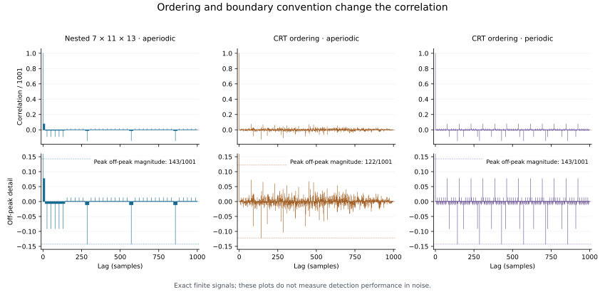

# From Synchronicity to Synchronization: The 7–11–13 Structure in Modular Recurrence and Barker Coding

**Matthew Chenoweth Wright**  
Monolithic LLC · 25 October 2026  
**Research note:** SYNC-71113-001 · Version 1.0.0  
**Status:** AI-assisted mathematical and computational preprint; exploratory synthesis; not peer reviewed.

**Reproducibility companion:** [definitions, executable verification, complete sequences, and numerical tables](research/sync-71113/README.md).

## Abstract

The triple $(7,11,13)$ connects two established mathematical structures: pairwise-coprime cyclic recurrence and the three largest possible odd lengths of binary Barker sequences. This note asks what that connection establishes about synchronization. Three counters advancing by one position per common tick traverse all 1,001 joint states before returning. Separately, Barker sequences of lengths 7, 11, and 13 have off-peak aperiodic autocorrelation magnitudes at most one. Their standard nested product has length 1,001 but a largest off-peak magnitude of 143, so its normalized peak sidelobe is $1/7$. A Chinese-remainder ordering of the same tensor entries has an aperiodic peak sidelobe of 122 for the specified sequences and origin; its periodic peak sidelobe remains 143, as an exact factorization proves. An additional elementary result establishes that $(7,11,13)$ uniquely maximizes the least common multiple of three positive integers with sum at most 31. The budget was selected from the triple itself and is not an independently motivated physical constraint. The paper supplies proofs, exact finite calculations, an explicit account of prior work, and a prospective comparison protocol. It distinguishes a meaningful encounter with a numerical pattern from causal synchronization, empirical performance, and a proposed physical law. The results identify a concrete signal-design construction and its limitations; they provide no evidence of a universal 7–11–13 dynamical principle.

**Keywords:** synchronization; synchronicity; Barker sequences; Chinese remainder theorem; autocorrelation; coprime cycles; nested codes; reproducibility.

## 1. The question and its evidential scope

The investigation began with a question about systems exhibiting a “seven by eleven by thirteen dynamic.” The product $7\cdot11\cdot13=1001$ immediately supplies a recurrence model. A subsequent literature search revealed a stronger connection: 7, 11, and 13 are the largest three possible odd Barker-code lengths [2]. These codes have a defined correlation property used to identify signal timing [4,5].

The encounter can be described as synchronicity in the ordinary sense of a personally meaningful coincidence. That description concerns how a connection is experienced. Here, **synchronization** refers to operational questions about phase, timing, or signal alignment. A mathematical relation between the numbers does not, by itself, establish a causal relation between events that led someone to notice them.

There are three distinct questions:

1. What follows exactly from the specified integers and update rules?
2. Which useful properties are already established in coding theory?
3. Does a combined construction improve a defined engineering task under fair comparison?

The first two can be answered in this note. The third remains an experimental question. No probability of a “chance coincidence” is reported: neither the collection of numerical patterns that might have attracted attention nor the literature-search selection process was specified in advance.

The motivation arose within the author's broader EFMW research activity. The results below use conventional arithmetic and signal processing. No derivation of the triple from an EFMW field equation is supplied, and no EFMW-specific physical validation is claimed.

## 2. Exact recurrence on three cycles

Let $a,b,c$ be positive integers. Define a discrete state

$$
x_n=(n\bmod a,\ n\bmod b,\ n\bmod c),
\qquad n\in\mathbb Z_{\ge0}.
$$

One common clock tick advances every counter by one position in its respective cycle. For a physical tick duration $\tau>0$, the component periods are $a\tau,b\tau,c\tau$.

**Proposition 1 — joint recurrence.** The first positive return of the full state is

$$
T_{\rm ticks}=\operatorname{lcm}(a,b,c).
$$

**Proof.** A return occurs precisely when $a\mid n$, $b\mid n$, and $c\mid n$. The smallest positive integer satisfying these divisibilities is their least common multiple. The same argument applies to return to any fixed initial phase triple. $\square$

For pairwise-coprime lengths, the Chinese remainder theorem additionally identifies every residue triple with exactly one integer modulo $abc$ [1]. Therefore

$$
\mathbb Z/1001\mathbb Z
\cong
\mathbb Z/7\mathbb Z\times
\mathbb Z/11\mathbb Z\times
\mathbb Z/13\mathbb Z,
$$

and the specified update traverses all 1,001 joint states. This is a special case of a general theorem. Primality is sufficient for the required coprimality, but is not necessary: $(9,10,11)$ is also pairwise coprime.

The numbers 31 and 1,001 describe different quantities. There are $7+11+13=31$ individual counter positions across the three components, while the joint configuration space contains their product, 1,001 states. A physical implementation need not have a cost proportional to the sum of the lengths; binary counters, for example, have a different storage model.

### 2.1 Recurrence does not establish spontaneous synchronization

The update rule already supplies a shared tick. It contains no coupling mechanism, no attraction from arbitrary frequencies, and no recovery after disturbance. Observing its predicted return would verify the imposed arithmetic rather than discover a synchronizing force.

Likewise, periods and frequencies must be distinguished. Periods $(7\tau,11\tau,13\tau)$ give a joint return at $1001\tau$. Frequencies $(7f_0,11f_0,13f_0)$ give a joint phase return at $1/f_0$. These are different specifications.

For ideal angular frequencies $\omega_p=2\pi/(p\tau)$, $p\in\{7,11,13\}$, let the actual frequencies be $\omega_p+\delta\omega_p$. At the nominal return time $T_0=1001\tau$, the unwrapped phase error relative to the ideal motion is exactly

$$
\Delta\theta_p(T_0)=1001\tau\,\delta\omega_p.
$$

A longer recurrence interval therefore permits more accumulated phase error at fixed frequency error. Nothing in coprimality removes that sensitivity. Coupled, noisy, or drifting oscillators require a separate dynamical model.

## 3. Why these three lengths matter in coding theory

For a finite bipolar sequence $b=(b_0,\ldots,b_{L-1})$, with $b_j\in\{-1,+1\}$, define its aperiodic autocorrelation by

$$
A_b(k)=\sum_{j=0}^{L-1-k}b_jb_{j+k},
\qquad 0\le k<L.
$$

The main peak is $A_b(0)=L$. The Barker condition is $|A_b(k)|\le1$ for every $1\le k<L$. Small sidelobes make an aligned sequence distinguishable from its shifted copies; practical uses include frame synchronization and radar pulse compression [4,5].

The established odd-length classification allows only $L\in\{3,5,7,11,13\}$ for nontrivial odd binary Barker sequences [2]. Thus 7, 11, and 13 have a specific distinction as the three largest lengths in that class. This does not mean arbitrary sign patterns of those lengths are Barker codes. The ordering of the signs is essential.

We use the standard representatives listed in [2]:

| Length | Bipolar sequence |
|---|---|
| 7 | $[+,+,+,-,-,+,-]$ |
| 11 | $[+,+,+,-,-,-,+,-,-,+,-]$ |
| 13 | $[+,+,+,+,+,-,-,+,+,-,+,-,+]$ |

All numerical claims in this note refer to these representatives, their stated orderings, and zero-based indexing. The general odd-length classification is a cited theorem, not a theorem re-proved by the accompanying finite program.

## 4. A literal $7\times11\times13$ signal construction

### 4.1 Nested ordering

For sequences $a$ and $b$, define their Kronecker product by

$$
(a\otimes b)_{im+j}=a_i b_j,
\qquad m=\operatorname{length}(b).
$$

The nested signal

$$
s=B_7\otimes B_{11}\otimes B_{13}
$$

has length 1,001. Explicitly,

$$
s_n=
B_7\!\left(\left\lfloor n/143\right\rfloor\right)
B_{11}\!\left(\left\lfloor n/13\right\rfloor\bmod11\right)
B_{13}(n\bmod13).
$$

Nested Barker constructions are prior work. Donato, Hadad, and Funes describe a family of lengths $2^a3^b4^c5^d7^e11^f13^g$ and discuss the effects of nesting on correlation [3]. The construction here is an instance of that family; no priority claim is made for multiplying Barker lengths or for the resulting length 1,001.

For a block product $a\otimes b$, splitting an aperiodic correlation sum at block boundaries gives

$$
A_{a\otimes b}(qm+r)
=A_a(q)A_b(r)+A_a(q+1)A_b(m-r),
\qquad 0\le r<m,
$$

where correlations outside their finite support are zero. In particular, at a whole-block shift,

$$
A_{a\otimes b}(qm)=mA_a(q).
$$

Applying this identity to $a=B_7$ and $b=B_{11}\otimes B_{13}$ yields

$$
A_s(286)=143A_{B_7}(2)=-143.
$$

Hence the composite cannot retain the individual Barker bound. Direct integer calculation of every off-peak lag confirms that 143 is the largest absolute sidelobe. Repeating the calculation for all six orders of the three factors gives the same maximum, although the lags attaining it differ.

### 4.2 Chinese-remainder ordering

A second ordering reads the same three-factor tensor along the CRT phase orbit:

$$
u_n=B_7(n\bmod7)\,B_{11}(n\bmod11)\,B_{13}(n\bmod13),
\qquad 0\le n<1001.
$$

The CRT bijection ensures that both $s$ and $u$ enumerate the same tensor entries, but in different orders. Such a reordering need not preserve aperiodic autocorrelation.

Define periodic autocorrelation by

$$
P_b(k)=\sum_{j=0}^{L-1}b_jb_{(j+k)\bmod L}.
$$

**Proposition 2 — CRT correlation factorization.** For the specified CRT-ordered product,

$$
P_u(k)=P_{B_7}(k\bmod7)\,
       P_{B_{11}}(k\bmod11)\,
       P_{B_{13}}(k\bmod13).
$$

**Proof.** As $j$ runs over one complete length-1,001 period, $(j\bmod7,j\bmod11,j\bmod13)$ runs once over the complete Cartesian product. The sum of the three-factor product therefore factors into three independent sums. Each is the corresponding periodic autocorrelation. $\square$

For the chosen base codes, the periodic correlation at a nonzero shift is $-1$ for lengths 7 and 11, and $+1$ for length 13. At shift zero it equals the length. Consequently the full correlation distribution is exact:

| Divisibility of lag $k$, $0\le k<1001$ | $P_u(k)$ | Number of lags |
|---|---:|---:|
| Divisible by none of 7, 11, 13 | 1 | 720 |
| Divisible by 7 only | -7 | 120 |
| Divisible by 11 only | -11 | 72 |
| Divisible by 13 only | 13 | 60 |
| Divisible by 7 and 11 only | 77 | 12 |
| Divisible by 7 and 13 only | -91 | 10 |
| Divisible by 11 and 13 only | -143 | 6 |
| $k=0$ | 1,001 | 1 |

Thus $u$ has fundamental period 1,001: a shorter repeating shift would have periodic correlation 1,001, which the table excludes. The maximum off-peak periodic magnitude is 143.

In contrast, direct computation gives a maximum aperiodic magnitude of 122, attained at positive lag 143. That result is tied to the stated representatives and finite-window origin. It is not a claim about every cyclic shift or sign-equivalent representative.

### 4.3 Reproduced correlation results

| Signal and correlation convention | Length / main peak | Peak absolute sidelobe | Sidelobe/main | Amplitude ratio in dB |
|---|---:|---:|---:|---:|
| $B_7$, aperiodic | 7 | 1 | $1/7$ | -16.901961 |
| $B_{11}$, aperiodic | 11 | 1 | $1/11$ | -20.827854 |
| $B_{13}$, aperiodic | 13 | 1 | $1/13$ | -22.278867 |
| $B_7\otimes B_{11}\otimes B_{13}$, aperiodic | 1,001 | 143 | $1/7$ | -16.901961 |
| CRT product $u$, aperiodic | 1,001 | 122 | $122/1001$ | -18.281485 |
| CRT product $u$, periodic | 1,001 | 143 | $1/7$ | -16.901961 |

Decibel entries use $20\log_{10}(\text{sidelobe}/\text{main})$. The two length-1,001 aperiodic results differ by approximately 1.38 dB. This is a deterministic difference for two specified orderings, not a demonstrated advantage in a noisy detection task.

*Figure 1. Correlations are divided by the main peak, 1,001. Positive lags are shown, including zero. The lower panels expose off-peak structure. Complete integer values are supplied in the companion CSV.*

The odd-length Barker classification also gives an immediate obstruction: **no binary sequence of length 1,001 can be a true Barker sequence** [2]. Naming a long signal a nested or compound Barker code refers to its construction, not to preservation of the strict Barker condition.

## 5. A conditional optimum for three counters

A different question concerns recurrence length under a specified component-size budget:

$$
M_3(B)=
\max_{\substack{a,b,c\in\mathbb Z_{>0}\\a+b+c\le B}}
\operatorname{lcm}(a,b,c).
$$

**Proposition 3 — the 31-position result.** $M_3(31)=1001$, uniquely attained by the unordered triple $(7,11,13)$.

**Proof.** Order the lengths as $a\le b\le c$.

If a pair has a common factor of at least two, then

$$
\operatorname{lcm}(a,b,c)
\le \frac{abc}{2}
\le \frac12\left(\frac{31}{3}\right)^3
<552<1001.
$$

The middle inequality follows from the arithmetic–geometric mean inequality. It remains to consider pairwise-coprime triples, for which the least common multiple equals $abc$.

If $a\le6$, then

$$
abc\le a\left(\frac{31-a}{2}\right)^2
\le6\left(\frac{25}{2}\right)^2
=937.5<1001.
$$

The last bound uses that $a(31-a)^2/4$ is increasing for $0<a\le6$. Also, $a\ge11$ would force $a+b+c\ge33$. Therefore only $a=7,8,9,10$ remain. Under ordering, the sum bound, and pairwise coprimality, their largest possible products are:

| Smallest length $a$ | Maximizing admissible triple | Largest product |
|---:|---|---:|
| 7 | $(7,11,13)$ | 1,001 |
| 8 | $(8,9,13)$ | 936 |
| 9 | $(9,10,11)$ | 990 |
| 10 | None | — |

To see the finite reduction directly: for $a=7$, $b+c\le24$; products above or equal to $11\cdot13=143$ require $(b,c)=(11,13)$ or $(12,12)$, and the latter is not coprime. For $a=8$, the only possible coprime values of $b$ between 8 and 11 are 9 and 11; these give at best $c=13$ and no admissible $c$, respectively. For $a=9$, only $b=10$ permits an admissible $c$, with maximum $c=11$. For $a=10$, ordering and the sum bound force $b=10$, violating coprimality. The displayed maximum and uniqueness follow. $\square$

The companion independently enumerates all 865 unordered positive-integer triples with sum at most 31 and agrees with the proof. Neighboring budgets demonstrate the scope of the result:

| Position budget $B$ | Maximizing unordered triple | $M_3(B)$ |
|---:|---|---:|
| 29 | $(7,9,13)$ | 819 |
| 30 | $(9,10,11)$ | 990 |
| 31 | $(7,11,13)$ | 1,001 |
| 32 | $(9,10,13)$ | 1,170 |
| 33 | $(9,11,13)$ | 1,287 |

This budget was chosen after noticing that $7+11+13=31$. It is an exploratory conditional result, not a preregistered discovery or a universal optimum. Allowing a different number of components, changing the cost model, or changing the budget gives a different problem. No claim of mathematical novelty is made.

## 6. Arithmetic distinctions and selection effects

The identity

$$
7\cdot11\cdot13=1001=10^3+1
$$

explains why multiplying a three-digit decimal block by 1,001 repeats that block: for example, $123\cdot1001=123123$. It also supplies divisibility rules based on alternating three-digit blocks. These are consequences of base-ten representation.

The triple is the first member of the prime-constellation family $(p,p+4,p+6)$ recorded in OEIS A022005 [6]. That classification, the decimal identity, and the Barker-length classification concern different mathematical properties. Their coexistence is interesting, but neither their number nor their rhetorical appeal supplies a physical likelihood ratio.

The analysis has searched for useful descriptions of a triple already selected. This differs from deriving that triple before inspecting a system and then confirming its predicted appearance. An empirical claim needs the latter structure, or an explicit correction for the selection process.

## 7. What an engineering advantage would require

### 7.1 Energy and alignment must be controlled

Longer unnormalized codes carry more energy when chip amplitude and chip duration are held fixed. An apparent benefit from increasing length can therefore reflect increased transmitted energy.

For a length-$N$ bipolar signal $s$, let $v=s/\sqrt N$, so $\|v\|_2=1$. In the aligned real-valued model

$$
y=\sqrt E\,v+\eta,\qquad
\eta_j\stackrel{\mathrm{iid}}{\sim}\mathcal N(0,\sigma^2),
$$

the matched-filter statistic is

$$
z=v^\mathsf{T}y=\sqrt E+v^\mathsf{T}\eta,
\qquad
\operatorname{Var}(z)=\sigma^2.
$$

Its aligned output signal-to-noise ratio is $E/\sigma^2$, independent of which unit-energy code is used. Code-dependent advantages must therefore be stated in terms of a task such as delay ambiguity, multipath, competing signals, or frequency offset. A low zero-offset sidelobe alone does not settle those tasks. Barker waveforms are also sensitive to Doppler offset [5].

### 7.2 Prospective benchmark, not an executed experiment

A follow-up comparison should freeze the following choices before generating or inspecting test outcomes:

| Item | Proposed specification |
|---|---|
| Task | Detect the presence and integer arrival delay of a finite signal in a longer observation window. |
| Candidate signals | The specified nested product and the specified CRT product, both of length 1,001. |
| Controls | Unselected random bipolar signals of length 1,001; random permutations preserving the candidate's sign counts; and a conventional length-1,001 design selected using a separately declared optimization budget. |
| Fairness | Equal energy, chip duration, pulse shaping, observation window, receiver search range, and declared processing budget. |
| Primary endpoint | Correct detection within a specified timing tolerance at a fixed false-alarm rate. |
| Perturbations | White noise, colored noise, frequency offset, timing drift, missing chips, and delayed interfering copies. |
| Separation | Design and threshold calibration use development data; code choice and detector thresholds are locked before independent test data. |
| Reporting | Report every declared condition, uncertainty intervals, failures, and computation cost. |

If a complex frequency-offset model is used, its waveform and noise conventions must be declared explicitly, for example

$$
y_n=\sqrt E\,v_{n-d}e^{2\pi i\nu n}+\eta_n,
$$

with zero extension outside the code support and stated distributions for delay $d$, offset $\nu$, and noise $\eta$. The follow-up must specify numerical ranges, trial counts, seeds, statistical analysis, and decision thresholds before execution. The table above is a design outline and is **not a complete frozen protocol**. No detection probability, robustness gain, or physical measurement has been produced in this note.

For oscillator experiments, the question is different again: whether a declared coupling law selects or stabilizes the ratio without having that ratio inserted as a target. A model that hard-codes 7, 11, and 13 cannot by its own recurrence demonstrate that nature independently selects them.

## 8. Verification, provenance, and limits

The numerical verification is deterministic and uses Python's standard library. All sequence entries, correlations, recurrence checks, and optimization comparisons use integer arithmetic. Floating-point operations are restricted to the displayed decibel conversions.

From the repository root:

~~~sh
python research/sync-71113/verify.py --check
~~~

This command reconstructs the outputs and compares them byte-for-byte with the published tables. It verifies:

- the 1,001 distinct CRT phases and the first joint return;
- the three input Barker conditions;
- all six nested orders, using two separate sequence-construction implementations;
- all 1,000 off-peak aperiodic correlations for each length-1,001 signal;
- every periodic CRT correlation against the factorized formula;
- the complete periodic correlation multiplicities;
- all 865 counter triples through two enumeration implementations;
- neighboring-budget controls and the reduced cases in Proposition 3.

The [companion](research/sync-71113/README.md) includes all generated sequences, complete correlation arrays, the enumeration table, and SHA-256 digests. The checks passed locally with Python 3.12.14. The supplied analytic proofs and finite calculations are not a claim of Lean or another proof assistant having checked the paper. An independent group has not replicated these checks as part of this work.

| Claim | Evidence status |
|---|---|
| The specified counters return after 1,001 ticks | Elementary proof and exact finite check |
| 7, 11, and 13 are the largest possible odd Barker lengths | Established external theorem [2] |
| The stated nested product has peak aperiodic sidelobe 143 | Exact finite check and a whole-block lower-bound identity |
| The stated CRT product has peak aperiodic sidelobe 122 | Exact finite check for this ordering and origin |
| CRT periodic correlations factor and have maximum sidelobe 143 | Analytic proof and exact finite check |
| $(7,11,13)$ uniquely maximizes recurrence under the stated 31-position budget | Elementary proof and exhaustive enumeration |
| Either construction improves an operational synchronization task | Unresolved; prospective benchmark required |
| The triple is selected by a new physical law or EFMW dynamics | Unsupported by this work |

## 9. Conclusion

The 7–11–13 observation leads to a legitimate intersection of modular recurrence and established low-sidelobe coding. The independent-counter model has 1,001 joint phases, while nesting the three Barker codes creates a signal of the same length. Those facts have different explanations and different performance implications.

The resulting long signal does not inherit the strict Barker property. A CRT ordering changes its finite-window autocorrelation, but a factorized periodic calculation retains a $1/7$ peak-sidelobe ratio. The recurrence optimum under a 31-position budget is exact and conditional. Together, these results turn a noticed coincidence into a reproducible technical question with clear limits and suitable conventional comparators.

## Authorship and assistance

Matthew Chenoweth Wright proposed the numerical investigation and the synthesis around synchronicity and synchronization. ChatGPT/Codex assisted with literature retrieval, mathematical exposition, executable calculations, verification, and editing. This disclosure does not imply independent review or empirical validation.

## References

1. Keith Conrad. *The Chinese Remainder Theorem*. University of Connecticut expository notes. [PDF](https://kconrad.math.uconn.edu/blurbs/ugradnumthy/crt.pdf). Used for the standard residue-product correspondence. Accessed 25 October 2026.
2. Kai-Uwe Schmidt and Jürgen Willms. *Barker sequences of odd length*. 2015. [arXiv:1501.06035v1](https://arxiv.org/abs/1501.06035v1). Gives the odd-length classification and the sequence representatives used here.
3. Patricio G. Donato, Matías N. Hadad, and Marcos A. Funes. *Uncorrelated binary sequences of lengths $2^a3^b4^c5^d7^e11^f13^g$ based on nested Barker codes and complementary sequences*. 2021 preprint. [arXiv:2103.05042v1](https://arxiv.org/abs/2103.05042v1). Used for nesting and its correlation limitations; the present note relies on [2] for the precise odd-length existence theorem.
4. MathWorks. *comm.BarkerCode — Generate bipolar Barker code*. [Official documentation](https://www.mathworks.com/help/comm/ref/comm.barkercode-system-object.html). Definition, representative codes, and frame-synchronization application. Accessed 25 October 2026.
5. MathWorks. *Waveform Analysis Using the Ambiguity Function*. [Official documentation](https://www.mathworks.com/help/phased/ug/waveform-analysis-using-the-ambiguity-function.html). Matched-filter interpretation, pulse compression, and Doppler sensitivity. Accessed 25 October 2026.
6. Warut Roonguthai / OEIS Foundation. *A022005: Initial members of prime triples $(p,p+4,p+6)$*. [Sequence record](https://oeis.org/A022005). Accessed 25 October 2026.
