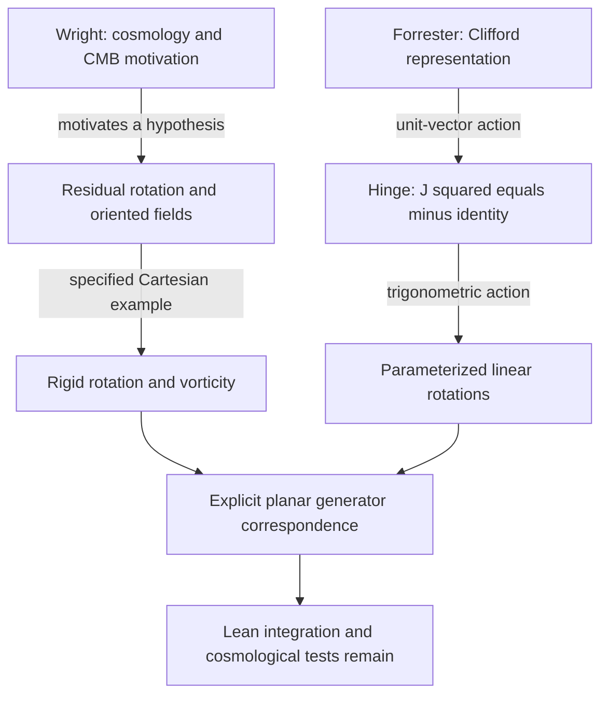

# Two Paths to Rotation

## From Cosmological Motivation to Clifford Algebra: An Explicit Bridge between EFMW and Ramtastic

**Matthew Chenoweth Wright and Chris Forrester — proposed joint authors**

17 October 2026 · Version 0.1 · Joint discussion draft

**Manuscript status.** Prepared at Wright's request for review with Forrester. Forrester's acceptance of coauthorship and approval of this manuscript have not yet been recorded. His contribution is attributed here through his published Ramtastic work; statements about his personal discovery history remain open for his confirmation.

[Papers catalogue](README.md) · [EFMW axioms](https://github.com/enuminous/EFMW-Axioms) · [Monolithic analysis](https://github.com/enuminous/Monolithic-102-Zoo-Lean4/tree/f2872a96290f8e66d340a12996f3edaded10ce6d/analysis) · [Ramtastic source](https://github.com/CasimirKnights/Ramtastic/tree/916ab476012852778edd9ca63aecf200a8e90ed1)

## Abstract

Two research programs approach rotation from different directions. Matthew Chenoweth Wright describes cosmology and cosmic microwave background (CMB) anisotropy as the motivation for EFMW's residual universal rotation hypothesis. His published mathematical work represents rotation through an asymptotic angular observable and, separately, a Cartesian velocity field and its curl. Chris Forrester's published Ramtastic construction begins with a real linear operator satisfying $J^2=-I$, called a hinge, and defines $R(\theta)=\cos\theta\,I+\sin\theta\,J$. Its accompanying explanation situates this construction in negative-definite Clifford algebra.

This paper reconstructs the available intellectual pathway and gives an explicit mathematical correspondence. With the standard orthogonal complex structure on a plane, the hinge action, extended by a fixed third axis and differentiated in time, generates exactly the Monolithic rigid-rotation field $v=(-\omega y,\omega x,0)$. Its curl is $(0,0,2\omega)$. Conversely, within this specified rigid family, nonzero angular velocity determines a normalized planar generator satisfying the hinge relation. A continuous, time-dependent angular velocity also gives a conditional bridge to the residual-rotation postulate.

The contribution is a source-traceable synthesis and a written derivation using established rotation mathematics. The cross-project correspondence is not yet a Lean theorem importing both projects. It neither establishes cosmic rotation from CMB anisotropy nor proves Ramtastic's broader architectural claims. The source record supports a convergence of mathematical formulations; it does not establish a complete, independently corroborated chronology of both authors' discoveries.

## 1. The question that joins the two programs

Rotation can enter a research program as a proposed feature of nature or as a property of an algebraic operation. These starting points create different obligations. The physical route must specify what rotates, relative to which observers, under what dynamics, and with what observable consequences. The algebraic route must specify a space, an operator, and the assumptions under which its action constitutes a rotation.

Wright's route asks whether a residual, oriented rotational degree of freedom belongs in a cosmological model. Forrester's published route asks what follows from an operator whose square reverses every vector. Their shared mathematical object becomes visible when the physical model is restricted to rigid rotation about a fixed axis and the algebraic model is given its standard Euclidean realization.

The bridge is useful because it makes translation precise. An angle becomes a group parameter; angular velocity becomes the coefficient of an infinitesimal generator; a velocity field becomes the action of that generator on position; and vorticity becomes twice the angular-velocity vector. Each identification has a domain and a normalization.

The word *pathway* in this paper has two meanings, kept separate throughout: the history supported by available documents, and the logical route through the equations. A logical reconstruction cannot establish which idea occurred first in an author's private work.

## 2. The documented intellectual pathway

### 2.1 Wright: cosmological motivation, residual rotation, and explicit fields

In the discussion commissioning this paper on 17 October 2026, Wright identified cosmology and CMB anisotropy as his route to the rotation hypothesis [R1]. This is a retrospective first-person account of motivation. The present paper supplies no dated early notebook, identified CMB map, or statistical analysis establishing the original discovery sequence.

The public EFMW-Axioms reconstruction attributes the historical residual-rotation statement to the axiom sheet of 6 March 2025 [R2]:

$$
\lim_{t\to\infty}\frac{d\theta}{dt}\ne0.
$$

The corresponding Lean structure is more explicit: it supplies a function $\omega:\mathbb R\to\mathbb R$, a limit $\omega_\infty$, a proof of convergence, and a proof that $\omega_\infty\ne0$. Its theorem `A1_residual_limit_nonzero` returns that supplied nonzero field. This accurately preserves the hypothesis; it does not derive a nonzero cosmic rotation from other physical laws [R3].

Wright's October paper *From Big Bang to Great Recursion* develops a related orientation question [R4]. A scalar rotation correction involving a square loses sign information. That paper therefore proposes an oriented vector and directional observables, while keeping their physical identification hypothetical. Its public commit is dated 6 October 2026. This is evidence of the published argument at that date, rather than a claim about the first conception of the idea.

The canonical Monolithic catalogue then distinguishes two relevant entries [R5]:

| Entry | Retained relation | Role |
|---|---|---|
| ME-055 | $\Omega_U=\nabla\times v_U$ | Vorticity of a proposed large-scale velocity field; classified as a cosmological construct. |
| ME-056 | $H^2=(8\pi G/3)\rho+\Lambda/3-k/a^2+\Omega_U^2/a^2$ | Illustrative rotating-universe expansion equation; classified as a working hypothesis requiring a rotating-metric derivation. |

Although both entries use $\Omega_U$, one is a vector curl and the other uses a scalar square. The catalogue's shared notation does not provide a theorem identifying their normalizations.

The analytic ME-055 module makes the vector-calculus part concrete. It defines actual Cartesian derivatives, curl, and divergence, and includes the field `rigidRotation ω x = ![-ω * x 1, ω * x 0, 0]`. The file entered the public history on 15 October 2026 [R6]. This supplies the mathematical endpoint needed for the comparison: an explicit field, rather than a verbal appeal to universal rotation.

### 2.2 Forrester: Clifford structure, a hinge, and a rotation action

Forrester's Bass write-up uses the Clifford convention

$$
c(v)^2=-\langle v,v\rangle I.
$$

For a unit vector, $J=c(v)$ therefore satisfies $J^2=-I$. The write-up assumes a spinor representation with skew-adjoint Clifford action and uses this square-minus-identity structure to generate rotations [R7].

The released Lean module abstracts away the Clifford origin. Its `Hinge` contains a real linear endomorphism and the equation `J.comp J = -LinearMap.id`. The definition `rotate` then supplies the trigonometric action. Six named theorems establish its addition law, distinguished angles, and fourth-power identity [R8]. Clifford representation data and an inner product are not fields of that bare structure.

The file header credits C. Forrester as author and Mael, identified there as Claude Opus 4.6, for formalization dated 13 April 2026. Its first public Git commit is dated 7 September 2026 UTC [R9]. The header date is an attribution in the artifact; the later commit is a repository-history observation. Neither establishes the date or source of Forrester's first insight.

His public explanation proposes a wider unification of mathematical constructions through rotation. This manuscript uses the explicit hinge construction and states its additional geometric assumptions. A claim that the circle alone supplies every analytic or spectral result is outside the bridge proved below. The published audit identifies concrete reasons to retain that boundary [R10].

No available source establishes whether a halting construction, a Dirac-operator problem, or another private line of work originally led Forrester to the hinge. That part of the intellectual history awaits his own account and supporting artifacts.

### 2.3 Where the pathways meet

The upper branches describe different motivations and constructions. Their meeting point is an exact realization within standard rotation theory. This diagram does not supply evidence for historically independent discovery or for a physical hypothesis.

## 3. Frozen scope and notation

The following derivations use ordinary real vector spaces and the standard Euclidean inner product unless another setting is explicitly stated. Spatial coordinates are $(x,y,z)$ with right-handed orientation. Angles are dimensionless; time has units $T$, position has units $L$, angular velocity has units $T^{-1}$, and velocity has units $L/T$.

| Symbol | Meaning |
|---|---|
| $J$ | A planar linear operator with $J^2=-I_2$. |
| $R_J(\theta)$ | $\cos\theta\,I_2+\sin\theta\,J$. |
| $\omega$ | A signed angular-velocity parameter, constant in Section 5. |
| $K$ | The three-dimensional extension of $J$ acting as zero on the fixed axis. |
| $\mathcal R(\theta)$ | The spatial rotation that fixes that axis. |
| $\boldsymbol\zeta$ | The vector curl $\nabla\times v$, corresponding to ME-055 in the selected model. |
| $q$ | A temporary label for the scalar $\Omega_U$ appearing in ME-056. It has no assumed identification with $\omega$ or $\lVert\boldsymbol\zeta\rVert$. |

The letter $q$ prevents an accidental identification of two differently typed catalogue quantities; it does not edit either canonical equation. No observational dataset or fitted cosmological parameter is an input to the mathematical proof.

## 4. From the hinge to algebraic structure

### Proposition 1. A hinge carries a complex-number action

Let $E$ be a nonzero real vector space and let $J\in\operatorname{End}_{\mathbb R}(E)$ satisfy $J^2=-I$. Define

$$
\rho(a+ib)=aI+bJ.
$$

Then $\rho$ is an injective unital real-algebra homomorphism from $\mathbb C$ into $\operatorname{End}_{\mathbb R}(E)$, with image $\operatorname{span}_{\mathbb R}\{I,J\}$.

**Proof.** Addition and the unit are immediate. Multiplication gives

$$
(aI+bJ)(cI+dJ)=(ac-bd)I+(ad+bc)J,
$$

which is exactly complex multiplication. If $aI+bJ=0$, multiplication by $aI-bJ$ gives $(a^2+b^2)I=0$. Since $E\ne\{0\}$ and the scalars are real, $a=b=0$. This proves injectivity. Equivalently, scalar multiplication $(a+ib)\cdot u=au+bJu$ makes $E$ a complex vector space. $\square$

The same calculation identifies the one-generator algebra $\mathbb R[s]/(s^2+1)$ with this operator algebra. Under the convention that the generator has square $-1$, this is $\mathrm{Cl}_{0,1}\cong\mathbb C$. For a general Clifford representation satisfying the displayed square relation, its restriction to a unit direction supplies such an action. Mathlib's Clifford implementation provides the square relation and the universal lifting property for this established construction [R11]. This is a local algebraic connection; it does not identify every spinor action with an action on physical position vectors.

### Proposition 2. The hinge gives a circle-group action

For a real hinge, define

$$
R_J(\theta)=\cos\theta\,I+\sin\theta\,J.
$$

Then

$$
R_J(\alpha)R_J(\beta)=R_J(\alpha+\beta),\qquad
R_J(0)=I,\qquad R_J(\theta)^{-1}=R_J(-\theta).
$$

**Proof.** Expand the product, replace $J^2$ by $-I$, and apply the sine and cosine addition identities. The inverse follows by setting $\beta=-\alpha$. Periodicity follows from the trigonometric functions, so the action factors through $\mathbb R/(2\pi\mathbb Z)$. $\square$

This is the algebraic content shared with the released Ramtastic angle theorems. No inner product is needed for the group law.

### Proposition 3. Euclidean rotation needs metric compatibility

On a real inner-product space, additionally assume $J^*=-J$. Then $R_J(\theta)$ preserves that inner product:

$$
R_J(\theta)^*R_J(\theta)
=(\cos\theta\,I-\sin\theta\,J)
 (\cos\theta\,I+\sin\theta\,J)=I.
$$

The equality uses both $J^2=-I$ and $\cos^2\theta+\sin^2\theta=1$. These are separate algebraic and metric hypotheses.

The distinction is necessary. For example,

$$
J_{\mathrm{ell}}=
\begin{pmatrix}0&-2\\[2pt]1/2&0\end{pmatrix}
\quad\text{satisfies}\quad J_{\mathrm{ell}}^2=-I,
$$

but maps the Euclidean unit vector $(1,0)$ to $(0,1/2)$. Its action is periodic without preserving the given Euclidean lengths [R10]. Thus a bare hinge does not automatically describe a physical rigid rotation in a prescribed metric. Forrester's prose Clifford setup includes skew-adjointness; the concrete bridge below establishes it by an explicit matrix choice.

## 5. The explicit bridge to Monolithic rigid rotation

### Proposition 4. The standard planar hinge generates the Monolithic field

Choose

$$
J=\begin{pmatrix}0&-1\\1&0\end{pmatrix},
\qquad J(x,y)=(-y,x).
$$

Direct multiplication gives $J^2=-I_2$ and $J^{\mathsf T}=-J$. Consequently,

$$
R_J(\theta)=
\begin{pmatrix}
\cos\theta&-\sin\theta\\
\sin\theta&\cos\theta
\end{pmatrix}
$$

is the ordinary oriented planar rotation. Extend it to three-space by fixing the third coordinate:

$$
\mathcal R(\theta)=
\begin{pmatrix}
\cos\theta&-\sin\theta&0\\
\sin\theta&\cos\theta&0\\
0&0&1
\end{pmatrix},\qquad
K=\begin{pmatrix}0&-1&0\\1&0&0\\0&0&0\end{pmatrix}.
$$

For $P=\operatorname{diag}(1,1,0)$ and $Q=\operatorname{diag}(0,0,1)$,

$$
K^2=-P,\qquad
\mathcal R(\theta)=Q+\cos\theta\,P+\sin\theta\,K.
$$

In particular, $K^2\ne-I_3$. The hinge relation applies on the rotating plane; the axis is fixed. Extending $J^2=-I$ to all of three-space would be an incorrect step.

Let $\omega\in\mathbb R$ be constant and let the flow be

$$
\Phi_t(r_0)=\mathcal R(\omega t)r_0.
$$

Differentiating the displayed matrix gives

$$
\frac{d}{dt}\Phi_t(r_0)=\omega K\Phi_t(r_0).
$$

Since $\mathcal R(\omega t)$ is invertible, every current position $r$ arises from some $r_0$. The associated Eulerian velocity field is therefore

$$
\boxed{v_\omega(x,y,z)=\omega K(x,y,z)=(-\omega y,\omega x,0).}
$$

This is exactly the coordinate expression of `MonolithicAnalysis.Vorticity.rigidRotation` in the pinned source [R6]. The bridge includes a derivative connecting motion to a field; it is more than a correspondence between two uses of the word rotation. $\square$

### Proposition 5. Curl, divergence, and the normalization of rotation

For the field above,

$$
\begin{aligned}
\nabla\times v_\omega
&=(0,0,\partial_x(\omega x)-\partial_y(-\omega y))\\
&=(0,0,2\omega),\\
\nabla\cdot v_\omega&=0,\\
\lVert\nabla\times v_\omega\rVert^2&=4\omega^2.
\end{aligned}
$$

These correspond to the existing `rigid_rotation_curl`, `rigid_rotation_divergence`, and `rigid_rotation_squared_curl` theorems [R6]. The last theorem is stated as the sum of three squared curl components, equal to the Euclidean squared norm used here. Their formalization concerns real Cartesian derivatives. Here they also follow by direct differentiation.

For an arbitrary unit axis $n\in\mathbb R^3$, put $K_n r=n\times r$. The vector triple-product identity gives

$$
K_n^2r=n(n\cdot r)-r.
$$

Thus $K_n^2=-I$ on $n^\perp$ and $K_n n=0$. The corresponding rigid field has

$$
v(r)=\omega n\times r,
\qquad \boldsymbol\zeta=\nabla\times v=2\omega n.
$$

The last curl identity follows by differentiating the three components of $\omega n\times r$, with $n$ and $\omega$ spatially constant. This arbitrary-axis extension is a written result here, rather than a claim that the pinned Monolithic file already proves it.

### Proposition 6. The correspondence can be reversed within the rigid family

Suppose the chosen model is $v(r)=\omega n\times r$ with a fixed unit axis and $\omega\ne0$. Its linear generator is $A=\omega K_n$. On the transverse plane,

$$
J=\left.\frac{1}{\omega}A\right|_{n^\perp}
\quad\Longrightarrow\quad J^2=-I_{n^\perp}.
$$

Alternatively, its nonzero vorticity determines the same field by

$$
v(r)=\frac12\boldsymbol\zeta\times r.
$$

This reverse statement fixes the origin and restricts the field to rigid rotation. Curl does not determine an arbitrary velocity field: adding a smooth gradient leaves curl unchanged, as the Monolithic theorem `curl_gradient_invariant` records [R6]. Translations, boundary conditions, and other curl-free contributions would require additional information.

The resulting dictionary is exact in the declared model:

| Geometric or kinematic quantity | Algebraic realization | Scope |
|---|---|---|
| Quarter-turn on a plane | $J$ with $J^2=-I_2$ | Standard Euclidean plane. |
| Finite planar rotation | $\rho(e^{i\theta})=R_J(\theta)$ | A circle action with the stated metric. |
| Spatial rotation about an axis | $\mathcal R(\theta)$ | Plane action plus a fixed axis. |
| Infinitesimal generator | $A=\omega K_n$ | Spatially uniform angular velocity. |
| Velocity | $v(r)=Ar$ | Rigid family about the chosen origin. |
| Vorticity | $\boldsymbol\zeta=2\omega n$ | Standard Cartesian curl. |

## 6. Connecting the bridge to residual rotation

The historical EFMW statement concerns an asymptotic angular rate, not necessarily constant-speed motion. Let $\omega:[0,\infty)\to\mathbb R$ be continuous, fix a unit axis $n$, and define

$$
\theta(t)=\theta_0+\int_0^t\omega(s)\,ds.
$$

Rotate about $n$ through the relative angle $\theta(t)-\theta_0$. The fundamental theorem of calculus and the same matrix derivative give

$$
v(t,r)=\omega(t)\,n\times r,
\qquad
\boldsymbol\zeta(t,r)=2\omega(t)n.
$$

The fixed axis and spatially uniform rate are assumptions. Continuity is an additional analytic condition for this integral construction; it is not supplied by the bare `ResidualUniversalRotation` structure. The angle action remains a group action, while a time-parametrized trajectory with variable rate need not satisfy $\Phi_{t+s}=\Phi_t\Phi_s$.

If the EFMW residual hypothesis is supplied,

$$
\omega(t)\longrightarrow\omega_\infty\ne0,
$$

then the model yields

$$
\boldsymbol\zeta(t,r)\longrightarrow2\omega_\infty n\ne0.
$$

This is a conditional mathematical connection between an asymptotic angular observable, a hinge-generated trajectory, and a vorticity field. The hinge itself admits $\omega(t)\equiv0$, decaying rates, and nonzero limiting rates. It therefore cannot select the residual hypothesis or make it a law of nature.

The bridge also identifies the boundary of the simple model. If the axis changes with time, generators at different times can fail to commute, and integrating only a scalar angle is generally insufficient. If the angular rate depends on position, derivatives of that rate enter the curl. Those cases require a new derivation.

## 7. Returning to cosmology and the CMB

### 7.1 Motivation and evidence have different roles

CMB temperature anisotropy means that the observed sky is not a uniform-temperature image. Statistical isotropy concerns the rotational invariance of its statistical description. A sky with temperature variations can be a realization of a statistically isotropic model. Thus the observation of anisotropy alone does not supply a cosmic angular velocity.

The Planck 2018 isotropy analysis reports broad agreement with standard predictions alongside several large-angle temperature anomalies; it does not claim corresponding unambiguous polarization anomalies [R12]. These results motivate carefully specified questions, rather than a direct inference from an unusual pattern to global rotation.

Saadeh and collaborators tested anisotropic Bianchi cosmologies against Planck temperature and polarization data. For the vector mode associated with vorticity, they reported the bound $(\sigma_V/H)_0<4.7\times10^{-11}$ at 95% credibility [R13]. This is a bound on the stated vector shear parameter in their model family, not a model-independent numerical bound on every proposed $\omega$. It illustrates the level of quantitative comparison required of a cosmological rotation proposal.

### 7.2 The scalar expansion term does not yet identify the generator

Write the scalar rotation parameter in ME-056 as $q$. Its retained algebraic form is

$$
H^2=\frac{8\pi G}{3}\rho+\frac{\Lambda}{3}
-\frac{k}{a^2}+\frac{q^2}{a^2}.
$$

Two consequences require no observation:

$$
q^2=(-q)^2,\qquad
-\frac{k}{a^2}+\frac{q^2}{a^2}
=-\frac{k-q^2}{a^2}.
$$

For constant $q$, the stipulated expansion expression is algebraically identical to one with effective curvature $k_{\mathrm{eff}}=k-q^2$. If $q$ varies in time, this rearrangement remains pointwise true but need not represent a constant-curvature degeneracy. Neither identity identifies the parameter with the field's angular velocity.

In particular, assigning $q^2=\omega^2$ and assigning $q^2=\lVert\boldsymbol\zeta\rVert^2$ differ by a factor of four in the rigid example. The correct identification requires a physical derivation, a definition of the observable, and consistent units and scale-factor conventions. A shared symbol does not supply them. The oriented-vector reconstruction in Wright's earlier paper is a hypothesis to be tested at this interface [R4].

### 7.3 What a physical extension must provide

The Euclidean construction is a kinematic model. A cosmological extension must specify a spacetime metric, a matter model, and an observer or fluid congruence; define rotation in that setting; and derive its evolution and observational signature. The spatial curl used here must be related to the appropriate covariant quantity in a controlled limit or exact specialization.

Rigid Euclidean rotation on all of $\mathbb R^3$ also has speed $|\omega|r_\perp$, unbounded with distance from the axis. It cannot simply be declared a global relativistic cosmic flow. A proposed relativistic model must handle its own causal and geometric constraints.

An empirical program would then freeze its CMB temperature and polarization predictions, nuisance treatment, comparison model, and evaluation rules before examining the testing data. An axis or rate selected from an anomaly cannot be counted as independently confirmed by that same anomaly. Out-of-sample predictions and independent observables are needed to test the hypothesis rather than repeat its construction.

## 8. What is established, and what remains

| Claim or obligation | Evidence status | Basis |
|---|---|---|
| Wright identifies cosmology and CMB anisotropy as his motivation. | **Supported but incomplete as history.** | First-person retrospective account; earliest source and data analysis not supplied. |
| Forrester's public presentation reaches a hinge through Clifford structure. | **Demonstrated as a source description.** | Bass write-up and released definitions; personal discovery sequence remains unresolved. |
| A hinge gives the trigonometric group law. | **Demonstrated.** | Written proof above and the existing Ramtastic angle theorems. |
| A bare hinge preserves an arbitrary given Euclidean metric. | **Rejected.** | Explicit counterexample; metric compatibility is required. |
| The standard planar hinge generates Monolithic's rigid field and curl. | **Demonstrated by written derivation.** | Propositions 4–5; endpoint field identities already occur in Monolithic Lean source. |
| The inverse correspondence holds for arbitrary velocity fields. | **Rejected.** | Curl-free additions destroy uniqueness; Proposition 6 is restricted to the rigid family. |
| The residual hypothesis implies a nonzero limiting curl in the stated time-dependent model. | **Demonstrated conditionally.** | Section 6, including continuity, a fixed axis, and spatial uniformity. |
| A Lean theorem imports both projects and proves the bridge. | **Unresolved / not supplied here.** | This publication adds a paper, not a new compiled bridge module. |
| CMB anisotropy establishes EFMW universal rotation. | **Hypothesis, not established.** | No rotating spacetime model or new observational comparison is supplied. |
| The bridge establishes all of Ramtastic's architectural or halting claims. | **Unresolved / outside scope.** | No such implication is proved, and the private halting construction is not an input. |

### 8.1 Formal verification and provenance

The original Ramtastic release and the successful diagnostic build in the audit are distinct artifacts. The frozen full release has a Dolbeault build defect; the audit records compilation and axiom checks for an unchanged 75-module subset, including the hinge module, as well as a successful full diagnostic checkout with a disclosed correction [R10]. A claim about the hinge results therefore does not certify the original full release as buildable.

The Monolithic source supplies its own Cartesian field theorems. The present paper does not rerun its full Lean pipeline and does not convert the new written propositions into kernel-checked cross-project results. Likewise, the `enuminous/papers` workflow verifies its existing local-repair package; a successful run of that workflow would not verify the bridge in this manuscript.

The synthesis follows the EFMW Zoo discipline of explicit assumptions, anti-circularity, counterexamples, and separated evidence statuses. It does not report a new 46-animal run, new observational experiment, or new whole-repository audit. The earlier Ramtastic audit remains separately attributed.

### 8.2 Novelty and intellectual contribution

The algebra of $J^2=-I$, complex scalar multiplication, planar rotations, and the factor-of-two relation between rigid angular velocity and vorticity are established mathematics. This paper claims no priority for those identities. Its contribution is their explicit correspondence across these two research programs, together with a source record and a precise account of the assumptions needed to return from algebra to cosmology.

The correspondence provides useful research structure even if a physical hypothesis later fails. Conversely, a physical observation supporting a rotating model would still leave separate proof obligations for broader algebraic claims. Neither program serves as independent empirical evidence for the other merely by sharing a mathematical construction.

## 9. The next concrete joint result

A formal bridge can be scoped before implementation:

1. Pin compatible Lean and Mathlib dependencies, recording any port required between the projects.
2. Construct the standard planar hinge and establish its Euclidean compatibility.
3. Define the action with a fixed third axis and prove its time derivative.
4. Identify that derivative's field with the existing `rigidRotation` definition and reuse the existing curl theorem.
5. Audit the compiled declarations and retain counterexamples to the stronger, unsupported statements.

**Acceptance condition:** the compiled result uses the actual imported or explicitly ported source definitions, proves the derivative and field equality under listed assumptions, and passes an axiom audit without `sorry` or new unproved axioms. An equivalence between two fresh lookalike definitions alone would not establish source correspondence. A build failure, a hidden metric assumption, or a missing source map leaves this obligation open.

The historical completion is different: Forrester can supply his earliest derivation and explain the role, if any, of halting, Clifford or Dirac geometry, or other work. Wright can attach the earliest dated cosmology notes and identify the particular CMB observations that motivated his hypothesis. Those additions would strengthen the history without changing the bridge's proof.

## 10. Conclusion

The two pathways meet in a specified mathematical object: an orthogonal complex structure on a plane, its rotation action, and the rigid velocity field generated by that action. The chain from $J^2=-I$ to $v=(-\omega y,\omega x,0)$ and $\nabla\times v=(0,0,2\omega)$ is explicit. In the rigid family, it can also be traversed in reverse.

That gives the rotation component of Wright's formal model a direct algebraic realization and gives Forrester's hinge a concrete kinematic interpretation. The residual cosmological hypothesis can be expressed through this realization under additional assumptions. Its physical truth, the two projects' wider ambitions, and the complete personal discovery histories remain separate questions with identifiable next steps.

## Contributions, authorship, and assistance

- **Matthew Chenoweth Wright:** EFMW research direction, retrospective account of cosmological motivation, published residual-rotation and oriented-vector proposals, and commissioning this synthesis.
- **Chris Forrester:** authorship of the Ramtastic construction attributed in its source and public Bass explanation. Participation in this manuscript, acceptance of its proposed joint byline, and endorsement of its conclusions remain pending.
- **AI assistance:** ChatGPT/Codex assisted with source comparison, derivation, drafting, and repository preparation. This assistance is not listed as a third author. Ramtastic's own formalization credits are retained in the cited upstream files.

## Source record and references

All repository comparisons below are frozen to the indicated revisions. The word *current* is avoided for substantive source claims so that later changes do not silently alter their meaning.

| Artifact | Frozen revision | Use in this paper |
|---|---|---|
| EFMW-Axioms | `248dcbf323b8ee3f25ccfcf346d29516d77019a1` | Historical reconstruction and residual-rotation structure. |
| Monolithic-102-Zoo-Lean4 | `f2872a96290f8e66d340a12996f3edaded10ce6d` | Canonical ME-055/056 entries and Cartesian vorticity source. |
| CasimirKnights/Ramtastic | `916ab476012852778edd9ca63aecf200a8e90ed1` | Upstream Bass explanation and hinge source. |
| enuminous/Ramtastic audit | `baa40e655b2453b7007bd2c633f44567a5179fef` | Separately published audit and verification evidence. |
| enuminous/papers, prior state | `56f7d321b19abd63161b743c24fcb0ea3b73c444` | Earlier Great Recursion essay. |

**[R1]** Wright, M. C. Retrospective account in the discussion commissioning this paper, 17 October 2026: cosmology and CMB anisotropy motivated his rotation pathway. Personal communication supplied by the commissioning author; not an independently dated record of the original insight.

**[R2]** Wright, M. C. / eNuminous. [EFMW-Axioms historical reconstruction](https://github.com/enuminous/EFMW-Axioms/blob/248dcbf323b8ee3f25ccfcf346d29516d77019a1/index.html) and [source-status paper](https://github.com/enuminous/EFMW-Axioms/blob/248dcbf323b8ee3f25ccfcf346d29516d77019a1/PAPER.md). These sources attribute the historical sheet to 6 March 2025; this paper has not independently authenticated that early date.

**[R3]** [EFMWAxioms/Axioms.lean](https://github.com/enuminous/EFMW-Axioms/blob/248dcbf323b8ee3f25ccfcf346d29516d77019a1/EFMWAxioms/Axioms.lean), declarations `ResidualUniversalRotation` and `A1_residual_limit_nonzero`.

**[R4]** Wright, M. C. [From Big Bang to Great Recursion: A Primordial Oriented-Rotation Hypothesis from the EFMW Post-156 Candidate Relations](https://github.com/enuminous/papers/blob/56f7d321b19abd63161b743c24fcb0ea3b73c444/great-recursion-primordial-rotation.md). October 2026. [Public addition commit, 6 October 2026](https://github.com/enuminous/papers/commit/c75de324675337c28b1ea5c7998f0d16dc605a81).

**[R5]** [Canonical Monolithic 102 catalogue](https://github.com/enuminous/Monolithic-102-Zoo-Lean4/blob/f2872a96290f8e66d340a12996f3edaded10ce6d/canonical/CANONICAL_102.md), entries 55 and 56. Their original source classifications are retained.

**[R6]** [Vorticity.lean](https://github.com/enuminous/Monolithic-102-Zoo-Lean4/blob/f2872a96290f8e66d340a12996f3edaded10ce6d/analysis/Vorticity.lean) and [VORTICITY.md](https://github.com/enuminous/Monolithic-102-Zoo-Lean4/blob/f2872a96290f8e66d340a12996f3edaded10ce6d/analysis/VORTICITY.md). [Public addition commit, 15 October 2026](https://github.com/enuminous/Monolithic-102-Zoo-Lean4/commit/6c25d5892f257bd1e14ad9738378303b4ad3e17a). Relevant declarations are listed in Sections 5 and 8; this is not a claim that every proposition in this paper occurs in that file.

**[R7]** Forrester, C. [The Bass Theorem, published explanation](https://github.com/CasimirKnights/Ramtastic/blob/916ab476012852778edd9ca63aecf200a8e90ed1/Ramtastic/Bass/README.md). Cited for its mathematical starting point and research ambition; its broader prose claims are not adopted without proof.

**[R8]** Forrester, C.; formalization credit recorded in the source to Mael / Claude Opus 4.6. [HingeRotation.lean](https://github.com/CasimirKnights/Ramtastic/blob/916ab476012852778edd9ca63aecf200a8e90ed1/Ramtastic/Bass/HingeRotation.lean). Namespace `Ramtastic.Bass.HingeRotation`; declarations `Hinge`, `rotate`, `rotate_zero`, `rotate_add`, `rotate_pi`, `rotate_halfPi`, `rotate_twoPi`, and `hinge_fourth_power`.

**[R9]** CasimirKnights/Ramtastic. [First public commit containing the hinge file](https://github.com/CasimirKnights/Ramtastic/commit/b4c31b8776c65090071a3009e8468e1e4eee8745), 7 September 2026 UTC. Repository chronology is distinguished from dates stated inside source comments.

**[R10]** eNuminous. [Ramtastic full Monolithic Zoo audit](https://github.com/enuminous/Ramtastic/blob/baa40e655b2453b7007bd2c633f44567a5179fef/audit/REPORT.md) and [verification record](https://github.com/enuminous/Ramtastic/blob/baa40e655b2453b7007bd2c633f44567a5179fef/audit/VERIFICATION.md), 16 October 2026. Includes the bare-hinge metric counterexample and the distinction between original and diagnostic builds. [Successful diagnostic workflow](https://github.com/enuminous/Ramtastic/actions/runs/38967875726).

**[R11]** Mathlib contributors. [Clifford algebra implementation and documentation](https://leanprover-community.github.io/mathlib4_docs/Mathlib/LinearAlgebra/CliffordAlgebra/Basic.html). Relevant interfaces include `ι_sq_scalar`, `CliffordAlgebra.lift`, and orthogonality identities. Documentation consulted 17 October 2026; this explanatory reference does not replace a frozen dependency manifest for a future Lean bridge.

**[R12]** Planck Collaboration. *Planck 2018 results. VII. Isotropy and statistics of the CMB*. Astronomy & Astrophysics **641**, A7 (2020). [arXiv:1906.02552v2](https://arxiv.org/abs/1906.02552v2). [DOI:10.1051/0004-6361/201935201](https://doi.org/10.1051/0004-6361/201935201).

**[R13]** Saadeh, D., Feeney, S. M., Pontzen, A., Peiris, H. V., and McEwen, J. D. *How isotropic is the Universe?* Physical Review Letters **117**, 131302 (2016). [arXiv:1605.07178v2](https://arxiv.org/abs/1605.07178v2). [DOI:10.1103/PhysRevLett.117.131302](https://doi.org/10.1103/PhysRevLett.117.131302).
